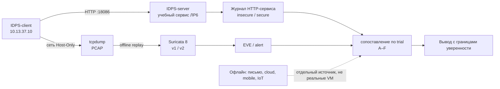

# Лабораторная работа №6 — Сквозная оценка защищённости и доказательное расследование

<div class="chapter-lead">
<p>Вы уже знаете, как установить факт сетевого обмена, выбрать точку наблюдения, связать сеть с хостом и изменить условие правила. Теперь вы получите <strong>единый учебный кейс</strong>: от определения разрешённых действий и разведки до проверки нарушения доступа, анализа EVE, ограничений телеметрии и итогового отчёта. В этой работе недостаточно получить alert или найти ошибку приложения: нужно показать, <strong>что реально произошло, откуда это известно и что наблюдатель не вправе утверждать</strong>.</p>
</div>

[Скачать пакет ЛР №6 v0.1](../../assets/downloads/idps-lab06-bundle-v0.1.zip){ .md-button .md-button--primary }
[SHA-256 пакета](../../assets/downloads/idps-lab06-bundle-v0.1.zip.sha256){ .md-button }

!!! info "Это одна лабораторная, а не одно двухчасовое занятие"
    Восемь этапов и 13 checkpoints рассчитаны ориентировочно на **16–20 академических часов** с остановками между занятиями. Преподаватель может принимать части отдельно. ЛР №1–5 **повторно не выполняются**; их среды и пакеты не меняются. Отработка отдельных официальных практических тем обозначена в конце работы; имитации облака, смартфона или IoT-устройства не выдаются за реальные испытания этих систем.

!!! warning "Границы действий"
    Допустимые цели: только собственные VM `IDPS-client` (`10.13.37.10`) и `IDPS-server` (`10.13.37.20`) в сети Host-Only IDPS-LAB. Допустимый активный сервис этого сценария — `10.13.37.20:18086`. Запрещено сканировать NAT gateway, адреса других студентов, сеть университета или Интернет, отправлять кому-либо учебное «фишинговое» письмо, выполнять DoS, извлечение реальных секретов или тестировать не перечисленные здесь системы. При обнаружении неожиданной цели/падении сервиса прекратите активные действия и сообщите преподавателю.

## Что студент доказывает

| Этап | Практический вопрос | Checkpoints | Тип evidence |
|---|---|---|---|
| 1. Scope | Почему действие разрешено? | C01 | ROE, адреса и маршрут |
| 2. Разведка | Что действительно доступно из точки клиента? | C02–C03 | вывод сканирования, HTTP, точка наблюдения |
| 3. Социальная инженерия | Какие признаки есть в письме и какие выводы недопустимы? | C04 | исходное `.eml`, разбор заголовков |
| 4. Сетевая видимость | Что видит Suricata при известном потоке? | C05–C06 | собственные PCAP и EVE |
| 5. Доступ к данным | Где нарушена авторизация и меняется ли она после исправления? | C07–C09 | HTTP-ответы, журнал приложения, анализ кода |
| 6. Облако / mobile / IoT | Какие источники доступны и чего они **не** доказывают? | C10–C11 | отдельная телеметрия и офлайн-артефакты |
| 7. Разбор инцидента | Можно ли связать действия, последствия и следы без скачков логики? | C12 | причинная временная шкала |
| 8. Отчёт | Может ли другой человек воспроизвести вывод? | C13 | отчёт, матрица тестов, защита |



**Разделяйте уровни.** PCAP доказывает захваченные пакеты в конкретной точке; HTTP-ответ показывает поведение учебного приложения; его JSONL-журнал — зарегистрированные обработчиком обращения; EVE — интерпретацию трафика движком Suricata. Сигнатура ЛР №6 отмечает **обращение к типу URI**, но не распознаёт право пользователя на объект. Поэтому alert не означает подтверждённую атаку и тем более не доказывает блокирование IPS.

## 0. Подготовка без переустановки стенда

Выполните [подготовку среды](../environment/), [Практикум 0](../orientation/) и [практический блок по scope](../pentest-foundations/) **только если это ещё не было сделано**. Используется прежняя конфигурация VirtualBox с сетевыми адаптерами `virtio-net`: менять их тип, сетевой режим, правила ЛР №1–5, сервисы `:8080` и `:9090` **не нужно**.

Скачайте ZIP и `.sha256` с этой страницы на обе VM предусмотренным преподавателем способом. На каждой машине проверьте файлы перед распаковкой:

```bash
sha256sum -c idps-lab06-bundle-v0.1.zip.sha256
unzip -l idps-lab06-bundle-v0.1.zip
unzip idps-lab06-bundle-v0.1.zip
cd idps-lab06-bundle-v0.1
```

Контрольная сумма, полученная с той же страницы, проверяет целостность опубликованного файла, но сама по себе не заменяет независимую проверку происхождения.

Нужны `python3` и `curl` на обеих VM; для сетевого этапа — установленные ранее `tcpdump`, `Suricata 8` и `jq` на сервере; `nmap` — на клиенте. Если `nmap` отсутствует, зафиксируйте это и используйте показанную ниже минимальную альтернативу для проверки **единственного разрешённого порта**. Автоматическую установку пакетов здесь не выполняем.

| Окно | Действия |
|---|---|
| `IDPS-server`, терминал 1 | `server/start-case.sh`, сервис в foreground |
| `IDPS-server`, терминал 2 | `tcpdump`, Suricata offline, JSONL, анализ исходного кода |
| `IDPS-client`, терминал | Nmap, `curl`, `client/six-cases.sh`, `client/emit-telemetry.sh` |
| Любой терминал | разбор локальных офлайн-артефактов и заполнение отчёта |

На `IDPS-server` из распакованного каталога:

```bash
bash server/start-case.sh insecure
```

Оставьте этот процесс работающим. Ожидаемое сообщение начинается с `LAB06 READY 10.13.37.20:18086 secure=False`. Скрипт проверяет наличие учебного IP и слушает только его, не занимает `8080/9090`. Если указанного адреса нет — сначала выясните причину, **не меняйте сеть VM вслепую**.

На `IDPS-client` проверьте ответ:

```bash
curl --noproxy '*' -i --max-time 5 http://10.13.37.20:18086/health
```

Ожидается HTTP `200` с полями `service=lab06` и `endpoint=/health`. Это доказывает, что клиент достиг именно учебного приложения, но **не** доказывает наличие работающей IDS. Если сервер недоступен, проверьте адреса/маршрут `ip route get 10.13.37.20`, работающий процесс, локальный firewall и ограничения scope; не переходите к сканированию других адресов.

**Наглядный тренажёр.** На `IDPS-client` можно открыть в браузере `http://10.13.37.20:18086/board`. У каждой пробы A–F сначала выберите, должен ли доступ быть разрешён, затем предскажите HTTP-код и нажмите «Выполнить». Браузер отправляет реальные запросы с маркерами `UI-A`…`UI-F`, поэтому их можно отличить от контрольной серии `A`…`F` в журнале. Тренажёр предназначен для самостоятельной проверки гипотез, а *сдаваемый* PCAP этапа 4 по-прежнему создаётся командой `client/six-cases.sh`.

---

## Этап 1. Разрешение и границы эксперимента — C01

Возьмите ранее созданный ROE из блока A2. Дополните его новым сервисом `10.13.37.20:18086` и отдельно укажите, что `10.13.37.20:8080/9090` существуют на стенде, но **не являются целями активного исследования ЛР №6**. Разрешённые действия: обращение к перечисленным маршрутам сервиса, ограниченное сканирование одного порта, короткий PCAP, offline Suricata, изучение подготовленных тестовых данных и исходников.

На клиенте:

```bash
ip -br -4 addr
ip route get 10.13.37.20
```

На сервере:

```bash
ip -br -4 addr
ss -ltn | grep 18086
```

**C01 сдан, если** в отчёте есть IP обеих VM, точный разрешённый порт/диапазон, адрес отправителя, целевой IP, условия остановки и результат проверки маршрута. *Нельзя* сделать вывод о разрешении на тестирование только на основании того, что адрес отвечает.

## Этап 2. Разведка, сервис и точка наблюдения — C02–C03

Прежде чем смотреть результат, сформулируйте прогноз: что скажет TCP connect scan об открытом порте `18086`, и скажет ли это что-либо об уязвимости приложения?

На клиенте:

```bash
nmap -sT -sV -Pn --reason -p 18086 10.13.37.20
curl --noproxy '*' -i http://10.13.37.20:18086/public
curl --noproxy '*' -i http://10.13.37.20:18086/robots.txt
```

Если **нет Nmap**, альтернативой для проверки TCP-доступности, но не для изучения всех его возможностей, служит:

```bash
python3 -c 'import socket; s=socket.create_connection(("10.13.37.20",18086),3); print("TCP CONNECT OK",s.getpeername()); s.close()'
```

`/robots.txt` — учебная подсказка к маршруту; она **не** определяет ни права доступа, ни фактическую защиту API. Сопоставьте найденный маршрут с запросом на `/public`. Запишите один проверенный факт и одну гипотезу, которую ещё надо тестировать. В отчёте явно укажите, выполняли ли именно Nmap или fallback.

На сервере найдите интерфейс, по которому ожидается обмен с клиентом:

```bash
ip route get 10.13.37.10
```

Запишите `dev ...` и поясните, почему для этого потока пригодна выбранная интерфейсная точка, а не любая случайная карта. Предыдущая ЛР №3 уже объяснила контраст LAB/NAT: **не нужно её повторять**.

**C02:** есть реальный результат ограниченной разведки, URI и объяснение, что открытый порт ≠ доказанная уязвимость. **C03:** зафиксированы адреса, интерфейс, выбранная точка наблюдения и ожидаемый поток.

## Этап 3. Социальная инженерия без рассылок — C04

Откройте подготовленный пакет письма:

```bash
sed -n '1,70p' offline/awareness-case.eml
```

Не открывайте приведённый в письме URL и не вводите учётные данные. Это файл-образец, адреса используют домен `.example.test`. Самостоятельно выпишите *From*, *Reply-To*, текст требования и ссылку. Ответьте:

1. Какие два-три признака делают сообщение подозрительным?
2. Что можно проверить по тексту/заголовкам, а чего здесь **нет** (полной SMTP-цепочки, SPF/DKIM/DMARC verdict, фактической доставки, перехода по URL)?
3. Как действовать сотруднику, не проверяя письмо переходом по ссылке?
4. Какая телеметрия потребовалась бы для уверенного вывода о состоявшейся компрометации?

**C04:** приложен текстовый разбор исходного `.eml`, а подозрение не приравнивается к доказанному фишинговому инциденту. Практика здесь — анализ артефакта, **не** имитация реального фишинга с людьми.

## Этап 4. Собственный PCAP и Suricata offline — C05–C06

Теперь проверим утверждение: «правило на `/api/tickets` найдёт именно те обращения, где нарушены права доступа». Это **гипотеза**, а не свойство правила. Мы построим матрицу из шести запросов с маркировками A–F, а оценку по фактическим разрешениям проведём на следующем этапе.

### C05. Захватите трафик на выбранном интерфейсе

На `IDPS-server` (второй терминал, из каталога ЛР):

```bash
LAB_IFACE=$(ip route get 10.13.37.10 | awk '{for(i=1;i<=NF;i++) if($i=="dev"){print $(i+1); exit}}')
printf 'Chosen interface: %s\n' "$LAB_IFACE"
mkdir -p evidence
sudo tcpdump -U -ni "$LAB_IFACE" -s 0 \
  -w "$PWD/evidence/lab06-insecure.pcap" \
  'host 10.13.37.10 and tcp port 18086'
```

Убедитесь, что `LAB_IFACE` совпадает с C03; если пусто или интерфейс неправильный — остановитесь до capture. **Не выключая tcpdump**, на клиенте из распакованного каталога выполните:

```bash
bash client/six-cases.sh insecure
```

Скрипт действительно отправляет шесть HTTP-запросов и сохраняет каждый HTTP-ответ в `evidence/response-insecure/A.json` … `F.json` **на клиенте**. Это не готовый лог: он создаётся вашими действиями. Запишите полученные HTTP-коды до просмотра EVE. Затем завершите `tcpdump` на сервере `Ctrl+C`.

На сервере:

```bash
sudo tcpdump -nn -r evidence/lab06-insecure.pcap -c 15
ls -lh evidence/lab06-insecure.pcap
```

Непустой PCAP, реальные src/dst и `18086` — **C05**. Наличие пакетов ещё не гарантирует, что Suricata распознала в них HTTP либо сформировала alert.

### C06. Запустите реальное правило на полученном PCAP

Рассмотрите `server/lab06-v1.rules`: тип `alert http`, направление `to_server`, содержимое `http.uri`, SID `1000006`. Вы должны предсказать, какие из A–F содержат искомый URI, **до** запуска replay. Правило не изучает ни owner, ни роль, ни HTTP-ответ.

На сервере:

```bash
sudo suricata -T -c /etc/suricata/suricata.yaml \
  -S "$PWD/server/lab06-v1.rules"
mkdir -p evidence/suri-v1
sudo suricata -r "$PWD/evidence/lab06-insecure.pcap" \
  -c /etc/suricata/suricata.yaml \
  -S "$PWD/server/lab06-v1.rules" \
  -l "$PWD/evidence/suri-v1"
```

Затем проверьте raw EVE, не ограничиваясь Live Console:

```bash
sudo test -s evidence/suri-v1/eve.json && echo 'EVE exists'
sudo jq -r 'select(.event_type=="alert" and .alert.signature_id==1000006) | [.timestamp,.src_ip,.dest_ip,.http.url,.alert.signature_id] | @tsv' \
  evidence/suri-v1/eve.json
```

Для удобного сопоставления по `trial` (A–F):

```bash
sudo python3 tools/evidence_matrix.py \
  --app evidence/insecure.jsonl \
  --eve evidence/suri-v1/eve.json
```

Если событий нет, **не вписывайте выдуманные alert**. Проверьте PCAP из C05, `suricata -T`, работоспособность разбора HTTP на порту `18086`, наличие `event_type:http` в EVE, условия правила и место вывода `eve.json`. Запишите конкретную причину, если не удалось получить ожидаемые записи. `sudo` может понадобиться из-за прав на файл `eve.json`.

**C06:** опубликованы строка правила, сырой EVE или проверяемый факт отсутствия результата с диагностикой, соответствие URI и SID. Обязательно объясните: `alert` в **offline IDS-режиме** ничего не блокировал в сети.

## Этап 5. Уязвимость разграничения доступа, изменение состояния — C07–C09

В учебном API есть две тестовые записи: `1001` принадлежит `alice`, `2002` — `bob`. Токен `alice-demo` относится к `alice`, `bob-demo` — к `bob`. Это **специально подготовленные учебные данные**, не реальная система пользователей. Запросы A–F уже сделаны на первом запуске.

### C07. Составьте ожидаемую матрицу авторизации

Заполните колонку `Правомерен по политике?` **до** просмотра ответов. Для запроса к записи проверяйте, совпадают ли пользователь и владелец; публичный путь не имеет владельца. Для доступа к архиву действует **то же** ограничение.

| Проба | Токен | URI | Правомерен? | Ожидаемый HTTP в защищённом режиме | Реальный HTTP в текущем режиме |
|---|---|---|---|---|---|
| A | alice | `/public` | ? | ? | ? |
| B | alice | `/api/tickets?id=1001` | ? | ? | ? |
| C | alice | `/api/tickets?id=2002` | ? | ? | ? |
| D | alice | `/api/archive?id=2002` | ? | ? | ? |
| E | bob | `/api/tickets?id=2002` | ? | ? | ? |
| F | bob | `/api/archive?id=2002` | ? | ? | ? |

Используйте `evidence/response-insecure/*.json` на клиенте и `evidence/insecure.jsonl` на сервере. Для получения событий с сервера:

```bash
python3 - <<'PY'
import json
for line in open('evidence/insecure.jsonl', encoding='utf-8'):
    e = json.loads(line)
    if e.get('trial') in tuple('ABCDEF'):
        print(e['trial'], e['actor'], e['owner'], e['http_status'], e['uri'])
PY
```

**C07:** отдельно показаны ожидаемое право доступа и фактическое поведение; факт получения чужой тестовой записи с `HTTP 200` обоснован как ошибка авторизации на уровне приложения (не «взлом Suricata»).

### C08. Найдите причину в исходном коде

На сервере откройте файл `server/lab6_case.py`. Найдите обработку маршрутов `/api/tickets` и `/api/archive`, определение пользователя из demo-токена и условие возврата `403`. Ответьте:

- Какой именно параметр контролирует выбор чужого объекта?
- Где нужно проверять **право пользователя на объект**, а не просто существование объекта?
- Почему наличие поля `owner` в JSON-ответе не заменяет серверную авторизацию?
- Может ли простое правило Suricata о пути `/api/tickets` определить, кому принадлежит объект? Почему?

**C08:** указаны конкретный участок кода, отсутствующая проверка, возможный результат и ограничение сетевой сигнатуры. Название класса ошибки без связи с кодом не принимается.

### C09. Проверьте контрольный защищённый режим

Остановите сервис в терминале 1 командой `Ctrl+C`. Не удаляйте каталог `evidence`. Перезапустите:

```bash
bash server/start-case.sh secure
```

Теперь на **клиенте**:

```bash
bash client/six-cases.sh secure
```

Сравните `evidence/response-insecure/` и `evidence/response-secure/` на клиенте, а также `insecure.jsonl` и `secure.jsonl` на сервере. В защищённом режиме код проверяет `actor != owner` до выдачи объекта. Зафиксируйте, какие ответы поменялись, какие не должны меняться и почему. Это контрольная демонстрация серверной авторизации; она **не доказывает**, что в приложении нет других ошибок.

**C09:** представлены парные запросы до/после и фактические HTTP-коды. Доказательство исправления — изменение поведения одной и той же серии, а не строка «уязвимость устранена».

### Оцените именно детектор, а не приложение

Вернитесь к **исходному** PCAP из уязвимого режима и EVE v1. Теперь независимо от сетевого alert поставьте метки ground truth: `1` — запрос нарушал определённую выше политику доступа, `0` — не нарушал. Напротив каждой метки отметьте, был ли alert SID `1000006`.

| | Alert=1 | Alert=0 |
|---|---|---|
| Нарушение политики=1 | TP | FN |
| Нарушение политики=0 | FP | TN |

Рассчитайте `precision=TP/(TP+FP)`, `recall=TP/(TP+FN)` и `FPR=FP/(FP+TN)`; если знаменатель нулевой — укажите, что метрика не определена. **В этой учебной матрице «атака/не атака» заменена явно указанной тестовой политикой доступа.** Она не даёт статистически репрезентативной оценки IDS на реальной сети.

Улучшите покрытие правила: сделайте **отдельную копию** `server/lab06-v2.rules`, оставьте исходный `lab06-v1.rules` неизменным. Дополните копию ещё одним правилом для **другого API-пути** с отдельным уникальным SID `1000007` (два правила на разные пути, а не два одинаковых SID). Перед редактированием сформулируйте, какие новые запросы должен заметить движок.

На `IDPS-server`:

```bash
cp server/lab06-v1.rules server/lab06-v2.rules
nano server/lab06-v2.rules
sudo suricata -T -c /etc/suricata/suricata.yaml \
  -S "$PWD/server/lab06-v2.rules"
mkdir -p evidence/suri-v2
sudo suricata -r "$PWD/evidence/lab06-insecure.pcap" \
  -c /etc/suricata/suricata.yaml \
  -S "$PWD/server/lab06-v2.rules" \
  -l "$PWD/evidence/suri-v2"
sudo jq -r 'select(.event_type=="alert" and (.alert.signature_id==1000006 or .alert.signature_id==1000007)) | [.http.url,.alert.signature_id] | @tsv' \
  evidence/suri-v2/eve.json
```

В v2 считайте **один общий результат alert=1 для пробы**, если на неё сработал хотя бы один из двух SID (не суммируйте две сигнатуры как два независимых запроса). Для проверки отдельных SID можно запустить `tools/evidence_matrix.py` дважды с `--sid 1000006` и `--sid 1000007`. Не подменяйте улучшение правила изменением трафика. Сравните TP/FP/FN/TN **на той же исходной серии A–F**: почему улучшение полноты по двум путям ещё не даёт знание о разрешениях объектов?

## Этап 6. Мобильная, IoT- и облачная телеметрия — C10–C11

**Физических облачных ресурсов, телефона и IoT-устройств в этом стенде нет.** Здесь вы проверяете, как разные источники **могли бы** поддерживать или ограничивать расследование, и делаете два *реальных HTTP POST* от клиента с пометкой `source`, которую приложение использует только как **тестовый атрибут**, а не как доказательство наличия устройства.

На `IDPS-server` запустите отдельный короткий capture на **уже определённом интерфейсе C03** (здесь снова вычисляем его значение, чтобы команда работала после нового входа в терминал):

```bash
LAB_IFACE=$(ip route get 10.13.37.10 | awk '{for(i=1;i<=NF;i++) if($i=="dev"){print $(i+1); exit}}')
sudo tcpdump -U -ni "$LAB_IFACE" -s 0 \
  -w "$PWD/evidence/lab06-telemetry.pcap" \
  'host 10.13.37.10 and tcp port 18086'
```

Убедитесь, что `LAB_IFACE` не пуст и совпадает с C03. Не завершая capture, на `IDPS-client`:

```bash
bash client/emit-telemetry.sh
```

Остановите capture и на сервере проверьте:

```bash
python3 - <<'PY'
import json
for path in ('evidence/insecure.jsonl', 'evidence/secure.jsonl'):
    try:
        for line in open(path, encoding='utf-8'):
            e=json.loads(line)
            if e.get('telemetry_source'):
                print(e['trial'], e['telemetry_source'], e['http_status'], e.get('payload_sha256'))
    except FileNotFoundError:
        pass
PY
```

**C10:** подтвердите реальные POST/ответы `202`, их наличие в журнале сервиса и **не приписывайте** им происхождение от физического смартфона или IoT-сенсора.

**C11:** изучите три независимых офлайн-артефакта:

```bash
cat offline/mobile-config.json
cat offline/cloud-audit.jsonl
cat offline/iot-telemetry.jsonl
```

Для каждого источника сформулируйте: наблюдаемый факт, возможный риск, необходимое дополнительное подтверждение, доступность его сетевому сенсору из C03. Пример правильного разграничения: `cloud-audit.jsonl` сообщает о *смоделированном* `GetObject`, но захваченный вами `lab06-telemetry.pcap` не является PCAP этого облачного обращения. Конфигурация с выключенной проверкой сертификата создаёт риск подмены канала, но не доказывает, что подмена уже произошла. Изменение `remote_config_change` в IoT-логе нуждается в проверке полномочий и источника.

## Этап 7. Реконструкция последствий — C12

Соберите временную шкалу **только настоящих действий вашей ЛР**: момент отправки запроса C или D, HTTP-ответ с чужим объектом, запись приложения, соответствующий или отсутствующий alert Suricata, результат повторной серии в `secure` режиме. Для каждой строки укажите временную отметку/маркер `trial`, источник и степень доказанности.

Не объединяйте фиктивную дату из `cloud-audit.jsonl` с вашей реальной хронологией как будто события происходили в одной инфраструктуре. Возможный дополнительный сценарий — документально описать, к чему *могло бы* привести раскрытие учебного архива, **не выполняя команды на постэксплуатацию ОС**.

**C12:** восстановлена причинная цепочка минимум для C и D, явно различаются «получен тестовый объект», «сработала сигнатура» и «компрометация хоста не установлена». Отсутствие alert для D само по себе не равно отсутствию сетевого трафика: его проверяют PCAP и журналом сервиса.

## Этап 8. Итоговый отчёт и защита — C13

Возьмите шаблон `report/lab06-report.md` из пакета. К каждому checkpoint приложите **идентификатор артефакта**, интерпретацию и ограничение вывода. Итоговая часть должна содержать:

1. Scope, условия остановки, состав стенда, фактические инструменты и версии.
2. Методику шести запросов: неизменные входные данные и различие режимов.
3. Выдержки из PCAP/EVE и HTTP/JSONL **с привязкой к `trial`**, а не исключительно скриншоты.
4. Матрицу авторизации, матрицу ошибок детектора v1, сравнение v2 на том же PCAP.
5. Вывод о причине ошибки приложения, демонстрации исправления и оставшихся ограничениях.
6. Разбор `.eml`, облачного/mobile/IoT-набора с отметкой **офлайн / смоделировано**.
7. Прямой ответ: **какое действие доказано, что заметила IDS, предотвратила ли она его и чего по имеющимся данным не узнать?**

**C13:** преподаватель может выбрать одну пробу, запросить исходный JSON/PCAP/EVE, проследить её от клиента до вывода и получить объяснение расхождения между ground truth и alert. Запрет на реальные внешние цели и факт выполнения исходного условия scope остаются частью оценки.

### Критерии оценивания

| Критерий | Баллы |
|---|---:|
| Scope, законность и фиксация точки наблюдения, C01–C03 | 15 |
| Обоснованный анализ письма, C04 | 8 |
| Реальный PCAP, Suricata, независимый EVE, C05–C06 | 20 |
| Авторизация, воспроизводимое исправление, анализ исходника, C07–C09 | 22 |
| Источники телеметрии и ограничения, C10–C11 | 12 |
| Доказательная хронология, C12 | 10 |
| Воспроизводимость отчёта, матрицы, защита, C13 | 13 |
| **Всего** | **100** |

!!! note "Почему здесь есть модель, а не все реальные технологии"
    Проверка синтаксиса письма и анализ офлайн-логов не равны тестированию почтовой инфраструктуры, облака, мобильного устройства или промышленного контроллера. Также offline Suricata — это **IDS-анализ сохранённого PCAP**, а не inline IPS. Такой подход сохраняет честные границы измерения: расширять стенд до активного IPS или реального cloud/mobile/IoT можно отдельным утверждённым заданием, но нельзя выдавать за уже выполненный эксперимент.

## Профилактика типичных ошибок

| Симптом | Что проверить **первым** |
|---|---|
| Порт `18086` недоступен | `ip route get`, IP привязки процесса, `ss -ltn`, scope; убедитесь, что сервер не остановлен |
| Порт занят | предыдущий процесс ЛР №6; не убивайте неизвестные службы и не используйте `killall python3` |
| PCAP пуст | правильный LAB-интерфейс, запуск capture **до** клиентских команд, фильтр порта, остановка `Ctrl+C` |
| EVE отсутствует | код завершения Suricata, права доступа, конфигурация `eve-log`, путь `-l` |
| Есть TCP, но нет HTTP alert | определился ли app-layer HTTP, совпали ли URI/порт/направление, загружено ли именно правило v1/v2 |
| Ожидали `403`, получили `200` | действительно ли остановлен режим `insecure` и запущен `secure`; не перепутана ли папка ответов |
| Нет отдельных событий `trial` | использовался ли `client/six-cases.sh`, совпадает ли серия с выбранным app-журналом |

### Сопоставление с программой

Блок A1–A2 ранее закрывал постановку задачи и scope. ЛР №6 дополняет обязательные практические направления: разведка/сканирование, социальная инженерия **на артефакте**, сетевая безопасность и IDS, проверка уязвимости веб-приложения, *моделируемые* облачный/mobile/IoT-контексты, последствия доступа, анализ кода, инструменты и итоговая отчётность. Не заявляйте, что эта работа замещает реальные испытания всех возможных платформ: точное покрытие определяется **измеренными действиями** и критериями официальной программы, а не количеством употреблённых в названии технологий.
