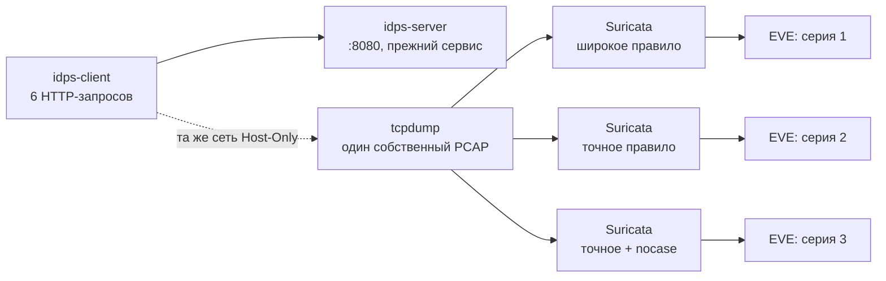

# Лабораторная работа №6 — Насколько хорошо работает правило обнаружения?

<div class="chapter-lead">
<p>В ЛР №5 вы изменили <code>content</code> одного правила и увидели, как изменился результат для двух запросов. Теперь поставим более сложный вопрос: <strong>какие события правило пропускает, а какие выделяет ошибочно?</strong> В этом опыте сетевой трафик остаётся прежним; трижды меняется только условие правила Suricata. Вы будете оценивать результат не по количеству <code>alert</code>, а по тому, какие конкретные запросы правило отметило и почему.</p>
</div>

Используем **уже настроенный стенд ЛР №1–5**: `idps-client` — `10.13.37.10`, `idps-server` — `10.13.37.20`, учебный HTTP-сервис `:8080`, Suricata 8 и EVE JSON. Переустановка ОС, изменение сетевых адаптеров VirtualBox, повторное выполнение прошлых лабораторных и запуск нового веб-сервера **не требуются**. Порт `9090` и прежняя Live Console остаются нетронутыми; в этом опыте первичным доказательством будет raw EVE.

[Скачать пакет ЛР №6 v0.2](../../assets/downloads/idps-lab06-bundle-v0.2.zip){ .md-button .md-button--primary }
[SHA-256](../../assets/downloads/idps-lab06-bundle-v0.2.zip.sha256){ .md-button }

!!! note "Проверка пакета"
    Как и в предыдущих работах, поместите ZIP и `.sha256` рядом, затем выполните `sha256sum -c idps-lab06-bundle-v0.2.zip.sha256` и `unzip -l idps-lab06-bundle-v0.2.zip`. Хеш с той же страницы подтверждает целостность опубликованной копии, но не является независимой подписью автора.

## Что проверяем

Сравните два тезиса:

- «Правило сработало — значит, произошло что-то действительно опасное».
- «Правило не сработало — значит, подозрительного запроса не было».

Оба утверждения требуют проверки. В ЛР №6 мы задаём **учебную разметку** шести запросов: три намеренно отнесены к группе «требует внимания» и три — к обычным запросам. Это *условная разметка тестового набора*, не реальные атаки, уязвимости или инциденты. Она позволяет вычислить TP/FP/FN/TN для **конкретного теста**, но не доказывает эксплуатацию приложения и не измеряет реальное качество IDS в Интернете.

| Проба | HTTP URI (от клиента к `:8080`) | Учебная группа |
|---|---|---|
| A | `/LAB6-REVIEW/A?lab6_case=A` | Требует внимания |
| B | `/LAB6-HEALTH/B?lab6_case=B` | Обычный запрос |
| C | `/lab6-review/C?lab6_case=C` | Требует внимания |
| D | `/LAB6-REVIEW/D?lab6_case=D` | Требует внимания |
| E | `/LAB6-STATUS/E?lab6_case=E` | Обычный запрос |
| F | `/normal?lab6_case=F` | Обычный запрос |



**Экспериментальная переменная:** условие одного правила (`content` и затем `nocase`), а не трафик, интерфейс, направление, адреса или SID. `rev` меняется только как версия правила. Это продолжает логику контролируемого опыта из ЛР №5.

## Подготовьте ранее созданный стенд

На `idps-server` убедитесь, что сервис ЛР №5 работает. Если в предыдущей работе он был остановлен, **перезапустите существующий сервис**, а не устанавливайте новый:

```bash
sudo systemctl is-active idps-lab-web.service
# Только если сервис не active:
sudo systemctl start idps-lab-web.service
curl --noproxy '*' -fsS http://10.13.37.20:8080/LAB6-PREFLIGHT
```

Сервис ЛР №5 возвращает строку `path=/LAB6-PREFLIGHT`. Если ответ отличается, не меняйте сетевую конфигурацию: проверьте, какой из ранее установленных учебных сценариев сейчас обслуживает `8080`. В качестве исходной базы нужна **именно проверенная реализация HTTP-сервиса ЛР №5**. Повторно проходить саму ЛР №5 не требуется.

На обеих VM распакуйте новый пакет в домашний каталог, как делали ранее:

```bash
cd ~
unzip idps-lab06-bundle-v0.2.zip
cd idps-lab06-bundle-v0.2
```

На сервере проверьте, что имеются `suricata`, `tcpdump`, `jq` и конфигурация `/etc/suricata/suricata.yaml`. На клиенте нужны только уже использовавшиеся `bash` и `curl`.

| Окно | Что в нём выполняется |
|---|---|
| `idps-server`, терминал 1 | Захват PCAP (только один раз) |
| `idps-server`, терминал 2 | Проверка и повторное воспроизведение PCAP в Suricata; EVE |
| `idps-client`, терминал | Отправка шести запросов и сохранение HTTP-ответов |

!!! warning "Границы учебного опыта"
    Команды предназначены только для `10.13.37.10 → 10.13.37.20:8080` в собственном стенде. Не меняйте диапазон захвата на университетскую сеть, не сканируйте внешние адреса и не используйте свои либо чужие реальные данные. Учебные пути `/LAB6-*` не содержат эксплойтов.

## Сначала сделайте прогноз

Откройте `report/lab06-report.md` и **до запуска Suricata** заполните три строки прогноза по пробам A–F:

1. **Широкое условие** — поиск `/LAB6-` (регистр учитывается).
2. **Точное условие** — поиск `/LAB6-REVIEW` (регистр учитывается).
3. **Точное условие + `nocase`** — поиск `/LAB6-REVIEW` без учёта регистра.

Должно ли точное правило обнаружить запрос C с нижним регистром? Должно ли широкое правило сработать на обычный `/LAB6-HEALTH/B`? Ответьте до просмотра EVE и объясните прогноз через свойство `content`.

## Получите один настоящий PCAP

На `idps-server` в терминале 1:

```bash
cd ~/idps-lab06-bundle-v0.2
LAB_IFACE=$(ip -o -4 addr show | awk '$4 ~ /^10\.13\.37\.20\// {print $2; exit}')
printf 'LAB_IFACE=%s\n' "$LAB_IFACE"
```

Если переменная пуста — остановитесь и проверьте IP сервера. Затем:

```bash
mkdir -p evidence
sudo tcpdump -U -nn -i "$LAB_IFACE" -s 0 \
  -w "$PWD/evidence/requests.pcap" \
  'host 10.13.37.10 and host 10.13.37.20 and tcp port 8080'
```

Фильтр захватывает **обе стороны TCP-обмена**, чтобы Suricata могла восстановить состояние соединения. Оставьте `tcpdump` работающим. На клиенте (из каталога пакета):

```bash
bash client/send-six.sh
```

Скрипт действительно выполняет шесть HTTP-запросов и сохраняет шесть ответов в `evidence/response-A.txt` … `response-F.txt`. Каждый ответ должен содержать соответствующий `path=...`. Это независимое подтверждение, что учебное приложение обработало запрос, а не готовый журнал, выданный студенту.

После завершения клиентского скрипта остановите `tcpdump` на сервере одним `Ctrl+C`. На сервере проверьте запись:

```bash
sudo tcpdump -nn -r evidence/requests.pcap 'tcp port 8080' | head -n 15
```

Этот просмотр показывает пакеты, но не доказывает, что правило Suricata загрузилось или сработало. Не запускайте клиентский сценарий повторно для следующих редакций правила — мы сравниваем **один и тот же PCAP**.

## Серия 1. Широкое условие

На `idps-server` откройте `server/lab06.rules`. В исходной версии SID `1000006` и условие:

```suricata
alert http 10.13.37.10 any -> 10.13.37.20 8080 (msg:"LAB06 training URI condition matched"; flow:established,to_server; http.uri; content:"/LAB6-"; sid:1000006; rev:1;)
```

Сначала проверьте правило, затем **обработайте созданный вами PCAP**:

```bash
sudo suricata -T -c /etc/suricata/suricata.yaml -S "$PWD/server/lab06.rules"
mkdir -p evidence/broad
sudo suricata -r "$PWD/evidence/requests.pcap" \
  -c /etc/suricata/suricata.yaml \
  -S "$PWD/server/lab06.rules" -l "$PWD/evidence/broad" -k none
```

Здесь `-r` означает обработку сохранённого PCAP, а `-k none` отключает проверку контрольных сумм для этого **учебного** файла захвата (на виртуальных интерфейсах исходящие пакеты могут выглядеть некорректно из-за checksum offloading). Это не рекомендация отключать проверки в рабочей IDS.

Сохраните редакцию правила и посмотрите HTTP-события и alert:

```bash
cp server/lab06.rules evidence/broad/lab06.rules
sudo chmod a+r evidence/broad/eve.json
python3 tools/eve-table.py evidence/broad/eve.json
```

Вспомогательный скрипт выводит A–F на основании **реальных HTTP-событий EVE и связанного `flow_id`**; вы можете независимо проверить его результат:

```bash
sudo jq -r 'select(.event_type=="http") | [.flow_id, .http.url] | @tsv' evidence/broad/eve.json
sudo jq -r 'select(.event_type=="alert" and .alert.signature_id==1000006) | [.flow_id, .alert.signature_id] | @tsv' evidence/broad/eve.json
```

Если шесть HTTP-событий не найдены, не записывайте отсутствие alert как отрицательный результат детектора. Сначала найдите проблему в захвате или обработке PCAP.

## Серия 2. Более точное условие

Не изменяя PCAP, на сервере откройте **тот же** файл `server/lab06.rules` и замените только:

```suricata
content:"/LAB6-";
```

на:

```suricata
content:"/LAB6-REVIEW";
```

Повышайте `rev:1` до `rev:2`. Header, `flow`, `http.uri`, SID и действие `alert` оставьте неизменными. Выполните независимую обработку того же PCAP:

```bash
sudo suricata -T -c /etc/suricata/suricata.yaml -S "$PWD/server/lab06.rules"
mkdir -p evidence/precise
sudo suricata -r "$PWD/evidence/requests.pcap" \
  -c /etc/suricata/suricata.yaml \
  -S "$PWD/server/lab06.rules" -l "$PWD/evidence/precise" -k none
cp server/lab06.rules evidence/precise/lab06.rules
sudo chmod a+r evidence/precise/eve.json
python3 tools/eve-table.py evidence/precise/eve.json
```

Сопоставьте значения **по каждой пробе**, а не только общее количество alert. Объясните, почему обращения B и E перестали удовлетворять правилу и что произошло с пробой C.

## Серия 3. Учитываем различие регистра

Снова оставьте прежние входные данные. В `server/lab06.rules` после `content:"/LAB6-REVIEW";` добавьте `nocase;` и повысите версию до `rev:3`. Итоговая последовательность должна содержать:

```suricata
http.uri; content:"/LAB6-REVIEW"; nocase; sid:1000006; rev:3;
```

Повторите проверку и обработку:

```bash
sudo suricata -T -c /etc/suricata/suricata.yaml -S "$PWD/server/lab06.rules"
mkdir -p evidence/nocase
sudo suricata -r "$PWD/evidence/requests.pcap" \
  -c /etc/suricata/suricata.yaml \
  -S "$PWD/server/lab06.rules" -l "$PWD/evidence/nocase" -k none
cp server/lab06.rules evidence/nocase/lab06.rules
sudo chmod a+r evidence/nocase/eve.json
python3 tools/eve-table.py evidence/nocase/eve.json
```

Почему в этой серии должен измениться результат для C? Поясните отличие **чувствительности правила к регистру** от нормализации HTTP, а также почему добавление `nocase` может увеличить число совпадений на данных, которых вы не тестировали.

## Рассчитайте TP, FP, FN и TN

Используйте **не сигнатуру в качестве истины**, а учебную разметку из таблицы A–F в начале лабораторной. Для каждой из трёх редакций классифицируйте шесть фактических наблюдений:

| Категория | Что произошло |
|---|---|
| **TP** | Запрос размечен «требует внимания» и отмечен правилом |
| **FP** | Обычный запрос отмечен правилом |
| **FN** | Запрос размечен «требует внимания», но правило его пропустило |
| **TN** | Обычный запрос не отмечен правилом; его наличие независимо подтверждено |

Дополнительно вычислите `Precision = TP / (TP + FP)` и `Recall = TP / (TP + FN)` и объясните, как менялся компромисс точности и полноты.

!!! warning "Не обобщайте результат"
    Называть обращение к `/LAB6-REVIEW` реальной атакой неправильно: это **тестовая метка**, заданная преподавателем. Даже если на этих шести запросах получатся идеальные показатели, они не распространяются автоматически на другие URI, URL encoding, регистры, TLS, другой трафик или реальные вредоносные действия. `alert` не доказывает компрометацию, а действие `alert` само по себе не блокирует запрос.

## Что сдаётся

Используйте `report/lab06-report.md` — тот же подход, что в предыдущих работах. **Никакой новой балльной системы, чекпоинтов и отдельной защиты проекта нет**.

| Evidence | Что он подтверждает |
|---|---|
| шесть HTTP-ответов A–F | приложение действительно обработало запросы |
| собственный `requests.pcap` | трафик существовал в выбранной точке наблюдения |
| три редакции `lab06.rules` | изменён именно критерий совпадения; SID сохранён |
| три EVE-файла / выборки raw EVE | вывод реального движка Suricata для одного PCAP |
| таблица TP/FP/FN/TN | сопоставление наблюдения с независимой учебной разметкой |
| короткое заключение | что улучшилось, что осталось неопределённым и почему |

## Если результат не совпадает с прогнозом

| Симптом | С чего начать проверку |
|---|---|
| `:8080` недоступен или не отвечает `path=...` | активен ли *прежний* `idps-lab-web.service` из ЛР №5; не подменён ли сервис |
| PCAP пустой | верно ли выбрана интерфейсная карта Host-Only; запускался ли tcpdump до клиента |
| HTTP-событий меньше шести | полный ли PCAP, захвачены ли обе стороны TCP, не остановлен ли tcpdump преждевременно |
| `suricata -T` вернул ошибку | исправьте именно синтаксис правила до воспроизведения PCAP |
| `alert` отсутствуют во всех трёх сериях | проверьте наличие HTTP в EVE, IP/порт/header, `http.uri`, `-S` и обработку `-r` |
| результаты выглядят как предыдущая серия | у каждой серии собственный `evidence/<label>/eve.json`; проверьте содержимое правила и версию |
| нет события, но вы записали TN | отрицательный результат недоказуем без независимого подтверждения входного HTTP |

**Итог лабораторной:** качественное обнаружение — это не «чем больше alert, тем лучше». Нужно проверить полноту получения данных, правило, тестовые положительные и отрицательные примеры и границы достоверного вывода. Следующая лабораторная продолжит эту цепочку, не изменяя уже созданный стенд.
