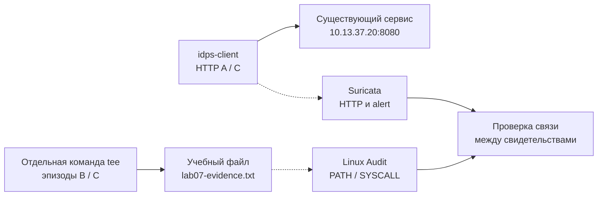

# Лабораторная работа №7 — Совпадение событий или причинная связь?

<div class="chapter-lead">
<p>В ЛР №6 вы установили, почему <code>alert</code> не равен доказанной атаке, и проверяли конкретные совпадения одного правила с настоящими HTTP-событиями. Но даже точный сетевой детектор не отвечает на другой вопрос: <strong>следует ли из близости сетевого и хостового событий, что одно вызвало другое?</strong> В ЛР №2 вы уже видели доказуемую цепочку «HTTP-запрос → действие учебного сервиса → Linux Audit». Теперь исследуем три контрольных эпизода, в которых события могут встречаться вместе, раздельно или независимо друг от друга.</p>
</div>

Используйте прежние две VM: `idps-client` (`10.13.37.10`), `idps-server` (`10.13.37.20`), текущий сервис `idps-lab-web.service` на `:8080`, Suricata 8, Linux Audit и `jq`. Мы не меняем VirtualBox, не устанавливаем пакеты, не создаём новое приложение и не перенастраиваем порт `9090`. ЛР №1–6 повторно выполнять не требуется.

[Скачать пакет ЛР №7 v0.1](../../assets/downloads/idps-lab07-bundle-v0.1.zip){ .md-button .md-button--primary }
[SHA-256](../../assets/downloads/idps-lab07-bundle-v0.1.zip.sha256){ .md-button }

!!! note "Проверка пакета"
    Загрузите ZIP и `.sha256` рядом, затем выполните `sha256sum -c idps-lab07-bundle-v0.1.zip.sha256` и `unzip -l idps-lab07-bundle-v0.1.zip`. Файл суммы с того же сайта проверяет опубликованные байты, но не заменяет независимую подпись.

## Один исследовательский вопрос

Предположим, NIDS сообщил о подозрительном HTTP-запросе, а Linux Audit в ту же секунду зарегистрировал изменение локального файла. Достаточно ли этого для утверждения: «именно запрос вызвал изменение»?

Проведите три эпизода на **одном стенде, с одним сетевым правилом и одной файловой областью аудита**:

| Эпизод | Что делает студент | Наблюдение, которое проверяем |
|---|---|---|
| A — только сеть | клиент отправляет `GET /LAB7-REVIEW/A?lab7_case=A` | HTTP + alert без записи в наблюдаемый файл |
| B — только хост | сервер самостоятельно добавляет строку в `/var/tmp/idps-lab/lab07-evidence.txt` | Audit без запроса с учебным маркером |
| C — близко по времени | клиент отправляет `GET /LAB7-REVIEW/C?lab7_case=C`; отдельно студент добавляет строку в файл | HTTP + alert + Audit, **но запись не вызвана веб-сервисом** |

В ЛР №2 связь была задана фактическим поведением приложения, которое обрабатывало специальный запрос. Здесь мы **не** меняем приложение, и записи в файл производит отдельная команда `tee`. Это сознательный отрицательный контроль: два близких события не образуют причинную связь только из-за одинакового времени.



**Прогноз до опыта:** заполните раздел 1 шаблона `report/lab07-report.md`. Для каждого эпизода предскажите, где появятся HTTP, alert и Audit. Главное — отдельно напишите, можно ли доказать причинную связь.

## Подготовка существующего стенда

На `idps-server` проверьте службу, адрес, инструменты и работу Linux Audit:

```bash
sudo systemctl is-active idps-lab-web.service
curl --noproxy '*' -fsS http://10.13.37.20:8080/LAB7-PREFLIGHT
command -v suricata && command -v jq && command -v auditctl && command -v ausearch
sudo auditctl -s
```

Нужны `active`, ответ с `path=/LAB7-PREFLIGHT` и `enabled 1` в выводе `auditctl -s`. Если сервис остановлен, используйте `sudo systemctl start idps-lab-web.service`. При `enabled 0` или `enabled 2` не пытайтесь менять политику аудита вслепую: исправление выходит за рамки лабораторной. Не запускайте вторую Suricata поверх уже работающего экземпляра из прошлой ЛР.

На **обеих** VM распакуйте пакет в домашнем каталоге:

```bash
cd ~
unzip idps-lab07-bundle-v0.1.zip
cd idps-lab07-bundle-v0.1
```

В этой работе открыты два серверных терминала: первый — live Suricata, второй — Linux Audit, проверки и сохранение evidence. Третий терминал — на клиенте.

## Подготовьте хостовое наблюдение

На `idps-server`, терминал 2:

```bash
cd ~/idps-lab07-bundle-v0.1
bash server/prepare-audit.sh
sudo auditctl -l -k "$(cat evidence/audit-key.txt)"
```

Скрипт создаёт только `/var/tmp/idps-lab/lab07-evidence.txt`, затем устанавливает watch `perm=wa` **на этот файл** и сохраняет уникальный ключ текущего прогона в `evidence/audit-key.txt`. Остальные правила Linux Audit не удаляются. `AUDIT_READY` подтверждает регистрацию watch, **но не появление будущего события**.

Почему наблюдаем именно один файл, а не целый каталог? В каталоге могут выполняться посторонние действия, которые нельзя автоматически относить к исследуемому эпизоду.

## Подготовьте сетевое наблюдение

На сервере, терминал 1:

```bash
cd ~/idps-lab07-bundle-v0.1
bash server/run-suricata.sh
```

Скрипт определяет прежний интерфейс Host-Only по адресу сервера, запускает `suricata -T` с `server/lab07.rules` и открывает отдельный EVE output `evidence/suricata/eve.json`. Если там уже есть файл предыдущего опыта, скрипт останавливается, чтобы не смешать прогоны. Оставьте Suricata работающей до завершения всех трёх эпизодов. Это прежний live-режим ЛР №1–5, а не новое развёртывание. `-k none` здесь унаследован от контролируемого учебного стенда с checksum offloading; на рабочих IPS отключение проверки контрольных сумм недопустимо использовать без отдельного анализа безопасности. Успешное `-T` означает только загрузку правила.

Правило с SID `1000007` ищет `/LAB7-REVIEW/` в нормализованном `http.uri` от клиента к серверу, порт `8080`. В отличие от ЛР №6 мы **не меняем правило**, а исследуем контекст его срабатывания и независимые хостовые события.

## Эпизод A — сеть без хостовой записи

На клиенте:

```bash
cd ~/idps-lab07-bundle-v0.1
bash client/send-case.sh A
```

Ожидается `CASE=A HTTP=200` и файл `evidence/response-A.txt` с точным `path=...`. На сервере, терминал 2:

```bash
cd ~/idps-lab07-bundle-v0.1
bash server/audit-snapshot.sh A
```

Ожидается пустой `evidence/audit-after-A.raw`: вы ещё не меняли **наблюдаемый файл**. Если в нём появились события, сначала выясните, кто записал файл, а не считайте опыт A отрицательным. Отсутствие Audit здесь не доказывает отсутствие всех действий веб-сервиса или ОС.

## Эпизод B — хостовая запись без сетевого запроса

**Не запускайте клиентский сценарий.** На сервере, терминал 2:

```bash
printf 'B_HOST_ONLY %s\n' "$(date --iso-8601=seconds)" | \
  sudo tee -a /var/tmp/idps-lab/lab07-evidence.txt
bash server/audit-snapshot.sh B
```

Ожидается Audit-событие записи; его путь относится к `lab07-evidence.txt`, а выполнение — к отдельной команде `tee`. Важно: отсутствие HTTP в этом эпизоде нужно подтверждать **для специально заданных URI ЛР №7**, а не для любого сетевого соединения сервера.

## Эпизод C — два соседних, но независимых события

На клиенте:

```bash
bash client/send-case.sh C
```

Сразу после подтверждённого ответа на сервере, терминал 2:

```bash
printf 'C_SEPARATE_HOST_WRITE %s\n' "$(date --iso-8601=seconds)" | \
  sudo tee -a /var/tmp/idps-lab/lab07-evidence.txt
bash server/audit-snapshot.sh C
```

Теперь появились оба типа следов, и они могут быть близки по времени. Но действие `tee` выполнено вами из терминала, а не HTTP-службой. **Не называйте это эксплуатацией уязвимости или подтверждённой цепочкой сетевой атаки.** В отчёте укажите, чем причинная атрибуция здесь отличается от контролируемого эпизода ЛР №2.

## Сохраните и проверьте реальные evidence

На сервере сначала остановите Suricata в терминале 1 одним `Ctrl+C`, дождавшись завершения. Далее, в терминале 2:

```bash
cd ~/idps-lab07-bundle-v0.1
sudo chmod a+r evidence/suricata/eve.json
python3 tools/check-eve.py evidence/suricata/eve.json
```

Проверка требует **двух настоящих** HTTP-событий A и C с точными URI, различными `flow_id` и по одному alert с SID `1000007` для каждого потока. Она не подменяет проверку хостовых артефактов и не объявляет причиной совпадение по времени. Посмотрите сырой источник независимо:

```bash
jq -c 'select(.event_type=="http" and (.http.url // "" | contains("LAB7-REVIEW"))) | {timestamp, flow_id, src_ip, dest_ip, url:.http.url, status:.http.status}' evidence/suricata/eve.json
jq -c 'select(.event_type=="alert" and .alert.signature_id==1000007) | {timestamp, flow_id, src_ip, dest_ip, sid:.alert.signature_id, action:.alert.action}' evidence/suricata/eve.json
```

Теперь найдите связанные группы Audit по `serial`, `PATH`, `SYSCALL`, `comm`/`exe`, PID и `auid` (если имеется):

```bash
sudo ausearch -k "$(cat evidence/audit-key.txt)" -i
```

Сравните `audit-after-A.raw`, `audit-after-B.raw` и `audit-after-C.raw`: A должен быть пустым, B содержать первую запись, C — добавленную запись следующего действия. Не принимайте количество строк Audit за количество действий — один syscall может давать несколько связанных records с одинаковым serial.

| Эпизод | HTTP-запрос с маркером | Alert SID 1000007 | Audit-запись файла | Доказана связь «HTTP вызвал запись»? |
|---|---|---|---|---|
| A | да | да | нет | нет |
| B | нет | нет | да | нет |
| C | да | да | да | **нет** |

Это **прогноз**, который нужно подтвердить своими файлами, а не заранее выданный результат. Если он не совпадает, сначала проверьте полную наблюдаемость, контроль входных действий и корректность установленного watch.

## Что сдаётся

Заполните `report/lab07-report.md`. Приложите ответы A/C, исходное правило, raw EVE, результат `tools/check-eve.py`, три снимка Audit и фрагменты `ausearch` с серийными номерами. Коротко объясните, что добавляет каждый источник и какое свидетельство требовалось бы для доказательства причинной связи в C.

Для удаления **только временного watch ЛР №7** после сохранения всех данных:

```bash
bash server/stop-audit.sh
```

Файлы ответа, EVE, Audit и отчёта не удаляйте. Не применяйте `auditctl -D` ко всем правилам системы.

## Диагностика

| Симптом | Что проверять прежде всего |
|---|---|
| Сервис не возвращает `path=...` | существующий `idps-lab-web.service` и порт `:8080`; не заменяйте приложение |
| Нет HTTP в EVE | тот ли `LAB_IFACE`, запущена ли Suricata до запроса, настроена ли запись HTTP в EVE |
| HTTP есть, но нет SID `1000007` | `suricata -T`, `-S`, текст URI, направление `10.13.37.10 → 10.13.37.20:8080` |
| В A появился Audit | выясните, кто изменил конкретный наблюдаемый файл; опыт A не завершён |
| После B/C нет Audit | `auditctl -s`, watch для файла, key текущего опыта, ошибки `sudo tee` |
| C даёт сетевой и хостовый след | это соответствует плану; **причинную связь такие следы сами по себе не доказывают** |
| Смешались два прогона | не переиспользуйте старый `eve.json`; новый опыт выполняйте в чистом каталоге |

**Вывод ЛР №7:** точность сигнатуры (ЛР №6) и наличие двух источников (ЛР №2) не заменяют доказательство причинной связи. Для SOC это граница между «события соседствуют», «события обоснованно связаны» и «инцидент подтверждён».
