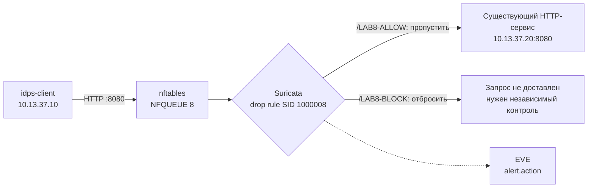

# Лабораторная работа №8 — Оповещение или реальное предотвращение?

<div class="chapter-lead">
<p>В ЛР №6 вы проверили, какие обращения действительно обнаруживает правило Suricata; в ЛР №7 — почему даже два соседних события не доказывают причинную связь. Теперь проверим новую границу: <strong>правило распознало HTTP-запрос — означает ли это, что запрос действительно остановлен?</strong> Ответ нельзя получить из одного текста сигнатуры или числа оповещений. Сопоставим состояние движка, действие IPS в EVE и независимый ответ существующего веб-сервиса.</p>
</div>

Используются **те же две VM**: `idps-client` (`10.13.37.10`) и `idps-server` (`10.13.37.20`), сервис `idps-lab-web.service` на TCP/8080 и установленная Suricata 8. Новых VM, приложений и сервисов не создаём. Linux Audit из ЛР №7 здесь не нужен: теперь предмет исследования — **сетевое предотвращение**, а не хостовая корреляция.

[Скачать пакет ЛР №8 v0.1](../../assets/downloads/idps-lab08-bundle-v0.1.zip){ .md-button .md-button--primary }
[SHA-256](../../assets/downloads/idps-lab08-bundle-v0.1.zip.sha256){ .md-button }

!!! note "Проверка пакета"
    Разместите оба файла рядом и выполните `sha256sum -c idps-lab08-bundle-v0.1.zip.sha256`, затем `unzip -l idps-lab08-bundle-v0.1.zip`. Сумма, опубликованная рядом с ZIP, подтверждает соответствие байтов, но не является отдельной цифровой подписью происхождения.

!!! warning "Управляемая граница эксперимента"
    Это первая лабораторная, где Suricata должна **повлиять** на передачу пакетов. Проверка предназначена только для изолированного Host-Only стенда. Мы создаём **одну отдельную таблицу** `inet spvo_lab08_ips` в `nftables`, не меняем постоянную конфигурацию firewall и не выполняем `iptables -F` / `nft flush ruleset`. Очередь ограничена направленным трафиком между двумя известными VM на TCP/8080. В обеих цепочках используется `queue ... bypass`, поэтому при остановке Suricata новые пакеты не должны оставаться заблокированными из-за отсутствующего обработчика очереди. После опыта таблица удаляется только штатным скриптом лабораторной. Если `nft` или поддержка `NFQ` отсутствуют, **не устанавливайте** дополнительные пакеты по собственной инициативе — зафиксируйте ограничение среды.

## Исследовательский вопрос и три доказательства

В правилах Suricata первое слово обозначает **действие**, например `alert` или `drop`. Но `drop` в тексте правила не означает автоматически, что на выбранной точке наблюдения действительно выполнялось inline-предотвращение. Для этого трафик должен проходить через механизм, который принимает решение движка и влияет на доставку пакетов.

В нашей Linux VM таким механизмом будет `NFQUEUE`: правила `nftables` передают соответствующие пакеты в очередь `8`, а Suricata запускается с `-q 8` и возвращает вердикт.



Три независимых слоя проверки:

1. **Конфигурация и наблюдение:** действительно ли Suricata запущена с `-q 8`, загружен именно файл `lab08.rules`, а в `nft` существуют две узкие очереди для направлений клиент → сервер и сервер → клиент?
2. **Действие движка:** есть ли в настоящем `eve.json` оповещение `SID 1000008` с `alert.action: blocked`?
3. **Результат обмена:** отличается ли HTTP-ответ для разрешённого и блокируемого маркера, и восстанавливается ли ответ для блокируемого маркера после выключения IPS?

**До запуска** заполните прогноз в `report/lab08-report.md`. Нельзя выдавать ожидаемый результат за уже наблюдавшийся.

## 1. Что именно проверяем

Используется одно правило с новым SID `1000008`:

```suricata
drop http 10.13.37.10 any -> 10.13.37.20 8080 (msg:"LAB08 controlled HTTP denial"; flow:established,to_server; http.uri; content:"/LAB8-BLOCK"; sid:1000008; rev:1;)
```

Разберите его до запуска. Заголовок ограничивает интересующий поток; `flow:established,to_server` задаёт TCP-контекст и направление; `http.uri` выбирает HTTP-представление; `content` ищет учебный маркер. Сам маркер не является вредоносным действием: мы намеренно блокируем **синтетическое** обращение, чтобы измерить работу IPS, а не наличие атаки.

Два контрольных URI:

| Запрос | Прогноз, когда IPS активна | Независимая проверка |
|---|---|---|
| `/LAB8-ALLOW?lab8_case=allow` | сервис отвечает HTTP 200 | ответ содержит ожидаемый `path=` |
| `/LAB8-BLOCK?lab8_case=block` | запрос не должен завершиться обычным HTTP 200 | результат curl + EVE `blocked` + восстановление после IPS |

Отсутствие HTTP 200 само по себе неоднозначно: возможно, веб-сервис неисправен, очередь неверно подключена или потерян сетевой пакет. Поэтому есть отдельные стадии **до**, **во время** и **после** IPS.

## 2. Проверка среды и исходного состояния

На **обеих** VM распакуйте пакет в домашнем каталоге:

```bash
cd ~
unzip idps-lab08-bundle-v0.1.zip
cd idps-lab08-bundle-v0.1
```

В работе понадобятся терминал клиента и два терминала сервера: первый для foreground Suricata, второй для установки/удаления временной таблицы, проверки логов и диагностики.

На `idps-server` в терминале 2:

```bash
cd ~/idps-lab08-bundle-v0.1
sudo systemctl is-active idps-lab-web.service
bash server/preflight.sh
```

Нужны `active` и `PREFLIGHT_OK`. Preflight проверяет доступность `/LAB8-BLOCK` **до защиты**, наличие NFQ в сборке Suricata, `nft`, загрузку правила через `suricata -T` и отсутствие старой учебной таблицы. Он не изменяет firewall. Если есть работающая Suricata из ЛР №7, сначала корректно завершите её; одновременно запускать два экземпляра над одним трафиком не нужно.

Здесь нет обязательной установки программы из Интернета. При неподдерживаемой NFQUEUE нельзя продолжать к активному опыту: напишите, какая предпосылка не выполнена.

## 3. Стадия BASELINE: обращение доступно без IPS

На `idps-client`:

```bash
cd ~/idps-lab08-bundle-v0.1
bash client/try-uri.sh baseline
```

Должны появиться `CASE=baseline`, `HTTP_CODE=200`, `HTTP_RESPONSE_CONFIRMED` и файл `evidence/response-baseline.txt` со строкой пути. Вы убедились, что **тот же тип маркера `/LAB8-BLOCK` ранее доходил до приложения**. Если HTTP недоступен, нельзя переходить к проверке блокирования.

## 4. Передайте только учебный HTTP-трафик в NFQUEUE

На сервере, терминал 2:

```bash
cd ~/idps-lab08-bundle-v0.1
bash server/enable-nft.sh
sudo nft list table inet spvo_lab08_ips
```

Скрипт создаёт только собственную таблицу `inet spvo_lab08_ips`, две цепочки `input` и `output` и два правила `queue num 8 bypass` для одной пары адресов и TCP/8080. Двусторонний захват важен для корректного восстановления TCP и анализа HTTP. Команда сохраняет вывод таблицы в `evidence/nft-enabled.txt`.

**Почему `bypass`?** Если на NFQUEUE ещё нет слушателя, ядро пропускает соответствующий трафик вместо того, чтобы безусловно его потерять. Это упрощает безопасное переключение учебной VM, но одновременно означает, что отключившаяся IPS больше не защищает данный поток. Политика доступности и политика защиты здесь не совпадают.

В серверном терминале 1 запустите обработчик очереди:

```bash
cd ~/idps-lab08-bundle-v0.1
bash server/run-inline.sh
```

Он запускает **реальную Suricata с `-q 8`**, использованием только `server/lab08.rules` (`-S`) и собственным каталогом `evidence/ips`. Дождитесь `Engine started.`. Логи предыдущих лабораторных не используются. Учебный ключ `-k none` **не применяется в этой активной работе**: проверка контрольных сумм — часть корректности предотвращения, и в случае несовместимости среды требуется отдельная диагностика, а не бесконтрольное отключение проверки.

## 5. Два разных сетевых исхода

Пока Suricata работает в терминале 1, на клиенте выполните:

```bash
bash client/try-uri.sh allow
bash client/try-uri.sh block
```

Первая команда должна завершиться HTTP 200 и подтвердить точное значение `path=/LAB8-ALLOW?lab8_case=allow`. Это положительный контроль доступности приложения **при действующей очереди**.

Для второй команды ожидается, что обычного HTTP 200 нет. Ошибка `curl` и код HTTP могут различаться в зависимости от того, на каком пакете произошло предотвращение; скрипт не считает конкретное значение ошибки доказательством. Если вы получили 200, **не фиксируйте успешное блокирование** — исследуйте, попадали ли пакеты в очередь, загрузилось ли правило и распознался ли HTTP.

В терминале 2 сервера проверьте счётчики и запишите их в отчёт:

```bash
sudo nft -a list table inet spvo_lab08_ips
```

После выполнения проб остановите Suricata в терминале 1 одним `Ctrl+C`. Учебная nft-таблица всё ещё существует, но `bypass` должен не мешать доступу при отсутствии слушателя. Проверьте содержимое настоящего EVE:

```bash
cd ~/idps-lab08-bundle-v0.1
sudo chmod a+r evidence/ips/eve.json
python3 tools/check-ips-eve.py evidence/ips/eve.json
```

Парсер проверяет наличие настоящего HTTP-события для разрешённого URI, alert SID `1000008` с `alert.action=blocked` и корректное направление адресов. Он не создаёт событий и не заменяет сетевую проверку с клиента.

Для независимого чтения:

```bash
jq -c 'select(.event_type=="alert" and .alert.signature_id==1000008) | {timestamp,flow_id,src_ip,dest_ip,action:.alert.action,signature:.alert.signature}' evidence/ips/eve.json
jq -c 'select(.event_type=="http" and (.http.url // "" | contains("LAB8-ALLOW"))) | {timestamp,flow_id,url:.http.url,status:.http.status}' evidence/ips/eve.json
```

Важное различие: в ЛР №5–7 мы анализировали факт совпадения и границы интерпретации `alert`. Здесь требуется именно **`blocked` в активном режиме и независимое подтверждение результата HTTP-обмена**. Количество строк EVE не равно автоматически количеству заблокированных TCP-пакетов.

## 6. Верните стенд в исходное состояние

На сервере, терминал 2:

```bash
cd ~/idps-lab08-bundle-v0.1
bash server/disable-nft.sh
sudo nft list table inet spvo_lab08_ips
```

Скрипт должен вывести `NFT_REMOVED`; последняя команда должна сообщить, что таблицы больше нет. Удаляется **только** специальная таблица с ожидаемыми маркерами лаборатории, а не другие правила `nftables`. Если проверка маркеров не проходит, скрипт отказывается удалять незнакомую конфигурацию.

На клиенте:

```bash
bash client/try-uri.sh restore
```

Теперь **тот же блокируемый маркер** должен снова дать HTTP 200 и строку `path=/LAB8-BLOCK?lab8_case=restore`. Если сервер после удаления очереди не отвечает, эксперимент нельзя считать успешно завершённым: диагностируйте доступность прежде, чем переходить к другим задачам.

## 7. Сопоставьте факты и ограничьте вывод

| Контроль | Что должно существовать | Что доказывает |
|---|---|---|
| BASELINE | HTTP 200 на `/LAB8-BLOCK` | сервис обслуживает такой URI без IPS |
| ALLOW | HTTP 200 при работающей NFQUEUE | очередь не нарушает заведомо разрешённый запрос |
| BLOCK | нет нормального HTTP 200 + EVE `blocked` | согласующиеся свидетельства предотвращения в данном тесте |
| RESTORE | HTTP 200 после удаления правил | ранее отказанный URI снова доступен без IPS |

Даже если все четыре результата совпали с прогнозом, нельзя распространять вывод на произвольные атаки или на защиту всего сервера. Наше правило проверяет только конкретный URI, точные адреса и порт, без TLS, и только внутри одного учебного сценария. Это **контрольная проверка предотвращения**, а не независимое доказательство защищённости веб-приложения.

## Что сдаётся

Используйте `report/lab08-report.md`. Приложите четыре `evidence/result-*.txt`, ответы `baseline`, `allow`, `restore`, снимок nft до удаления, конкретные EVE HTTP/alert, результат проверки `check-ips-eve.py` и подтверждение очистки. Сравните исходный прогноз и фактические результаты; отдельно объясните последствия `bypass`.

## Если результат не соответствует прогнозу

| Симптом | С чего начать |
|---|---|
| Нет `NFQ` в `suricata --build-info` | этот способ IPS в текущей сборке недоступен; не продолжайте без поддержки среды |
| `nft` отсутствует | инструмент не входил в подготовленный стенд; не устанавливайте новые пакеты в ходе работы |
| BASELINE не HTTP 200 | `idps-lab-web.service`, адрес/порт, неизменность сервиса |
| `Engine started.` не появляется | `suricata -T`, права NFQUEUE, журналы отдельного прогона |
| ALLOW не HTTP 200 | проверить обе цепочки и двустороннюю доставку, не считать BLOCK доказательством |
| BLOCK возвращает HTTP 200 | проверять `-q 8`, `drop`, URI, SID, IP, счетчики nft и EVE |
| BLOCK не HTTP 200, но EVE `blocked` нет | причина отказа не доказана; нельзя приписывать его IPS |
| После удаления таблицы RESTORE не HTTP 200 | проверить сервис и сеть; не считать стенд восстановленным |

**Итог ЛР №8:** текст `drop` — запрос на действие, `alert.action=blocked` — отчёт движка о решении, а фактическое прохождение или прекращение HTTP-обмена — отдельный наблюдаемый результат. Доказательность обеспечивается не одним логом, а сравнением контрольных состояний до, во время и после IPS.
