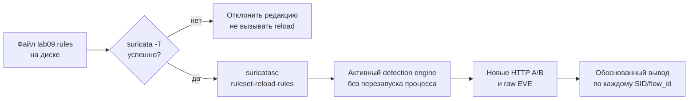

# Лабораторная работа №9 — Изменённое правило или активное правило?

<div class="chapter-lead">
<p>В ЛР №5 вы редактировали условие сигнатуры; в ЛР №6 измеряли последствия такой редакции для обнаружения; в ЛР №8 проверяли сетевое воздействие IPS. Теперь изучим эксплуатационную границу: <strong>если файл правила изменился, означает ли это, что работающая Suricata уже применяет новую логику?</strong> Мы сохраним один процесс обнаружения, проведём контролируемую смену его правил, отклоним повреждённую редакцию до применения и восстановим прежнее состояние.</p>
</div>

Используем тот же стенд: `idps-client` (`10.13.37.10`), `idps-server` (`10.13.37.20`), ранее установленную Suricata 8 и существующий `idps-lab-web.service` (TCP/8080). **Никаких новых VM, веб-сервисов, пакетов, файрволов и приложений не нужно.** В отличие от ЛР №8 эта работа выполняется в **пассивном IDS-режиме**, чтобы изменение правила не влияло на доступность учебного HTTP-сервиса.

[Скачать пакет ЛР №9 v0.1](../../assets/downloads/idps-lab09-bundle-v0.1.zip){ .md-button .md-button--primary }
[SHA-256](../../assets/downloads/idps-lab09-bundle-v0.1.zip.sha256){ .md-button }

!!! note "Целостность учебного пакета"
    Сохраните ZIP и `.sha256` в одном каталоге, запустите `sha256sum -c idps-lab09-bundle-v0.1.zip.sha256`, затем `unzip -l idps-lab09-bundle-v0.1.zip`. Эта проверка подтверждает соответствие опубликованных байтов, но не является независимой цифровой подписью.

!!! warning "Начните после восстановления стенда ЛР №8"
    На сервере не должна работать прежняя Suricata, а таблица `inet spvo_lab08_ips` должна быть удалена по инструкции ЛР №8. Нельзя создавать дополнительные фильтры `nftables`, менять службу `idps-lab-web.service` или экспериментировать в реальной корпоративной сети. Действия ограничены учебными HTTP-запросами в Host-Only сети.

## 1. Исследовательский вопрос

Suricata читает файлы правил при запуске, но умеет повторно загружать их без остановки обработки сетевых пакетов. Такая смена состояния состоит как минимум из трёх разных фактов:

1. **Файл на диске:** вы записали новую редакцию `lab09.rules`.
2. **Предварительная проверка:** Suricata приняла синтаксис новой редакции с помощью `suricata -T`.
3. **Активное состояние:** работающий процесс после команды `suricatasc` действительно использовал новую логику обнаружения для заново отправленного трафика.

Ни одна проверка по отдельности не заменяет остальные. Особенно важно, что `-T` проверяет конфигурацию и файл, но **не активирует** правило в уже работающем процессе.



Это приложение эксплуатационной модели главы 10: подготовка изменения → предварительная проверка → активация → проверка рабочего результата → откат. В эксперименте не требуется разрабатывать новую архитектуру IDS/IPS.

## 2. Что уже знакомо и что добавляется

В ЛР №5 был один изменяемый файл правила и проверка, какие URI совпали с новой редакцией. Здесь отличие в том, что **Suricata не останавливается между сериями**, а смена активного набора правил проводится отдельной командой управления через Unix socket. Синтаксис `content`, `http.uri`, `rev`, `sid` и EVE уже известен; новый элемент — `suricatasc` и доказательство состояния работающего процесса.

В пакете есть один рабочий файл `server/lab09.rules` и три эталонные редакции:

| Редакция | Условие | Назначение |
|---|---|---|
| `rev1.rules` | `http.uri; content:"/LAB9-ALPHA";` | исходное подтверждённое состояние |
| `rev2.rules` | `http.uri; content:"/LAB9-BETA";` | планируемое изменение |
| `rev-broken.rules` | заведомо неизвестный rule keyword | отрицательная проверка изменения, **не загружать** |

Правило имеет отдельный `SID 1000009`, действие `alert`, постоянный header `10.13.37.10 → 10.13.37.20:8080`. `rev` показывает редакцию, но **не является механизмом загрузки**. При запуске новый SID не конфликтует с правилами предыдущих лабораторных, потому что `-S` загружает только текущий учебный файл.

## 3. План четырёх серий до получения результатов

Клиент в каждой серии отправляет **два отдельных** запроса через `curl`; веб-приложение отвечает одинаковым типом подтверждения `path=...`. Отличаются только значения URI и метки фазы.

| Фаза | Что находится на диске | Какая логика должна быть активна | Alert ALPHA | Alert BETA |
|---|---|---|---|---|
| `before` | `rev1` | `rev1` | да | нет |
| `after` | `rev2`, успешно перезагружена | `rev2` | нет | да |
| `rejected` | повреждённая редакция, **без reload** | всё ещё `rev2` | нет | да |
| `rollback` | восстановлена и перезагружена `rev1` | `rev1` | да | нет |

Все восемь HTTP-запросов должны дойти до сервера и получить HTTP 200: мы специально выбрали действие `alert`, а не `drop`. **Наличие alert здесь означает обнаружение, но не блокирование.** Ожидания в таблице — это прогноз, который требуется сравнить с настоящим EVE.

Заполните раздел «Прогноз до эксперимента» в `report/lab09-report.md` **до** выполнения запросов.

## 4. Подготовка прежнего стенда

На обеих VM распакуйте архив из своего домашнего каталога:

```bash
cd ~
unzip idps-lab09-bundle-v0.1.zip
cd idps-lab09-bundle-v0.1
```

Используются три окна:

| Окно | Что выполняется |
|---|---|
| `idps-server` · SSH 1 | один foreground-процесс Suricata на LAB-интерфейсе |
| `idps-server` · SSH 2 | `suricata -T`, `suricatasc`, копирование редакций и чтение EVE |
| `idps-client` · терминал | восемь контролируемых запросов A/B в четырёх фазах |

На `idps-server`, SSH 2:

```bash
cd ~/idps-lab09-bundle-v0.1
sudo systemctl is-active idps-lab-web.service
bash server/preflight.sh
```

Требуются `active` и `PREFLIGHT_OK`. Проверка находит LAB-интерфейс по `10.13.37.20`, проверяет исходный `rev1` с помощью реальной `suricata -T`, доступность существующего HTTP-сервиса, наличие `suricatasc` и отсутствие работающей прежней Suricata. Если условие не выполнено — устраните именно его, не создавая новый стенд.

При наличии оставшейся после ЛР №8 nft-таблицы preflight откажется продолжать. Не удаляйте непонятные правила вслепую: сначала завершите штатную процедуру предыдущей работы.

## 5. Начальная редакция и работающий процесс

В SSH 1 на сервере:

```bash
cd ~/idps-lab09-bundle-v0.1
bash server/run-live.sh
```

Скрипт запускает Suricata **в пассивном режиме** на LAB-интерфейсе с `-S server/lab09.rules`, собственным журналом `evidence/live` и доступом к Unix socket (`unix-command.enabled=yes`). Набор правил из остальных работ не загружается. Учебный параметр `-k none` здесь допускается только в пассивном виртуальном захвате для исключения эффектов checksum offloading; в активной IPS ЛР №8 он не использовался. Оставьте процесс работать до завершения **всех** серий.

После сообщения `Engine started.` в SSH 2 проверьте интерфейс управления:

```bash
cd ~/idps-lab09-bundle-v0.1
mkdir -p evidence/commands
sudo suricatasc -c version | tee evidence/commands/version.txt
sudo suricatasc -c uptime | tee evidence/commands/uptime-before.txt
sudo suricatasc -c ruleset-stats | tee evidence/commands/ruleset-before.txt
```

Ожидается успешный ответ от **того же** работающего экземпляра. Если нет доступа к Unix socket, не подменяйте `suricatasc` запуском второго процесса или редактированием системного YAML. Сначала установите причину и не переходите к следующей фазе.

На `idps-client`:

```bash
cd ~/idps-lab09-bundle-v0.1
bash client/send-pair.sh before
```

Скрипт должен напечатать подтверждения `PHASE=before CASE=A/B HTTP=200 ... VERIFIED`. Ответы будут сохранены локально в `evidence/client/before-A.txt` и `before-B.txt`.

## 6. Новая редакция: предварительная проверка и активация

Теперь **не останавливая Suricata** скопируйте новую редакцию рабочего файла в SSH 2 сервера:

```bash
cd ~/idps-lab09-bundle-v0.1
cp server/revisions/rev2.rules server/lab09.rules
sha256sum server/lab09.rules | tee evidence/commands/rev2-file.sha256
sudo suricata -T -c /etc/suricata/suricata.yaml -S "$PWD/server/lab09.rules"
```

Если `-T` не прошёл, остановитесь и исправьте причину. После успешной проверки **активируйте** проверенную редакцию:

```bash
sudo suricatasc -c ruleset-reload-rules | tee evidence/commands/reload-rev2.txt
sudo suricatasc -c ruleset-stats | tee evidence/commands/ruleset-after.txt
sudo suricatasc -c ruleset-reload-time | tee evidence/commands/reload-time.txt
```

`ruleset-reload-rules` ждёт завершения операции. Ответ команды и статистика помогают подтвердить операцию, но **не заменяют** проверки реального трафика. Если команда вернула ошибку или новая редакция не активировалась, не заявляйте об успехе.

На клиенте:

```bash
bash client/send-pair.sh after
```

Ожидается HTTP 200 для **обоих** запросов, но alert уже должен относиться к `/LAB9-BETA`, а не к `/LAB9-ALPHA`. Это будет первым функциональным свидетельством успешного изменения работающего детектора.

## 7. Отрицательная проверка: повреждённый файл не должен попасть в эксплуатацию

В SSH 2 сервера разместите заведомо неверную редакцию **только для проверки**:

```bash
cp server/revisions/rev-broken.rules server/lab09.rules
sha256sum server/lab09.rules | tee evidence/commands/broken-file.sha256
sudo suricata -T -c /etc/suricata/suricata.yaml -S "$PWD/server/lab09.rules"
```

**В этом шаге ожидается неуспешный `-T`.** Если команда неожиданно прошла, не продолжайте как будто проверка завершилась. Требуется выяснить, почему файл с неизвестным ключевым словом был принят. Отрицательный результат задокументируйте в отчёте.

!!! danger "Не выполнять reload ошибочной редакции"
    Мы моделируем корректную процедуру change control: невалидный кандидат должен быть остановлен на предварительном этапе. Файл на диске поменялся, но мы **не вызываем** `ruleset-reload-rules`. Продолжение обработки старой активной редакцией не является экспериментом о поведении Suricata при неуспешном reload — такого reload мы здесь намеренно не производим.

На клиенте:

```bash
bash client/send-pair.sh rejected
```

Если Suricata продолжила работать с прежней активной редакцией `rev2`, обычные HTTP-ответы будут получены для обоих запросов, а alert останется у `/LAB9-BETA`. Зафиксируйте, почему именно этот результат отличается от содержания **невалидного** файла на диске.

## 8. Откат к подтверждённому состоянию

Верните исходную сохранённую редакцию в SSH 2 сервера:

```bash
cp server/revisions/rev1.rules server/lab09.rules
sha256sum server/lab09.rules | tee evidence/commands/rollback-file.sha256
sudo suricata -T -c /etc/suricata/suricata.yaml -S "$PWD/server/lab09.rules"
sudo suricatasc -c ruleset-reload-rules | tee evidence/commands/reload-rollback.txt
sudo suricatasc -c ruleset-stats | tee evidence/commands/ruleset-rollback.txt
sudo suricatasc -c uptime | tee evidence/commands/uptime-rollback.txt
```

На клиенте:

```bash
bash client/send-pair.sh rollback
```

Ожидается возвращение прежнего поведения: alert снова только на `/LAB9-ALPHA`. Один и тот же запущенный Suricata-процесс обрабатывает все восемь запросов. Для подтверждения нужны **фактические наблюдения**, а не только успешный возврат файла или ответ управления.

## 9. Подтверждение результатов в настоящем EVE

После четырёх серий в SSH 1 остановите Suricata одним `Ctrl+C` и дождитесь завершения. В SSH 2:

```bash
cd ~/idps-lab09-bundle-v0.1
sudo chmod a+r evidence/live/eve.json
python3 tools/eve-phase-table.py evidence/live/eve.json
```

Парсер только **читает реальные записи** EVE: по меткам в HTTP URI он находит четыре серии A/B, связывает alert `SID 1000009` по `flow_id` и проверяет активную редакцию для каждого подтверждённого запроса. Если не хватает хотя бы одного HTTP-события, он не выдаст отсутствие alert за корректное отрицательное решение. Это такая же доказательная дисциплина, как в ЛР №6.

Проверьте вывод и вручную на исходном журнале:

```bash
jq -r 'select(.event_type=="http" and (.http.url // "" | contains("lab9_phase="))) | [.flow_id,.http.url] | @tsv' evidence/live/eve.json
jq -r 'select(.event_type=="alert" and .alert.signature_id==1000009) | [.flow_id,.alert.signature_id,.alert.rev,.alert.action] | @tsv' evidence/live/eve.json
```

**Эталонная матрица** (заполнить результатами, а не переписывать как наблюдение):

| Серия | HTTP A | HTTP B | Alert A | Alert B | Версия в ответах `suricatasc` |
|---|---|---|---|---|---|
| before | есть | есть | есть | нет | исходная |
| after | есть | есть | нет | есть | новая |
| rejected | есть | есть | нет | есть | новая осталась активной |
| rollback | есть | есть | есть | нет | исходная восстановлена |

Если результаты не совпадают, сохраните сырой EVE, сообщения Suricata и ответы Unix socket, а затем объясните расхождение. Отсутствие совпадения не означает автоматически неисправность Suricata: сначала установите факт получения и разбора соответствующего HTTP-запроса.

## 10. Отчёт и границы заключения

В `report/lab09-report.md` заполните прогноз, команды/статусы `-T`, результат reload, контрольные суммы редакций, восемь HTTP-ответов, EVE-таблицу и объяснение отката. Отдельно сравните `uptime`: в эксперименте не предполагается перезапуск Suricata при смене правил.

Что можно заключить: **в рамках конкретного живого процесса, выбранного интерфейса и тестовых HTTP-проб активное правило изменилось после проверенного reload и вернулось после отката**.

Чего нельзя утверждать: что такой reload безопасен для любой нагрузки, любых сигнатур, IPS-режима или ограничений памяти; что отсутствие alert означает отсутствие события; что невалидное изменение само по себе могло вызвать отказ сервиса; что синтаксический `-T` проверяет эксплуатационные характеристики правила. В главе 10 также объясняется, почему во время reload может потребоваться дополнительная память.

## Если наблюдения расходятся

| Симптом | С чего начать проверку |
|---|---|
| Preflight не проходит | прежний процесс Suricata, остаток `spvo_lab08_ips`, действующий веб-сервис, исходный rev1 |
| `suricatasc` не подключается | существует ли **тот же** запущенный процесс и его Unix socket; не запускайте второй движок |
| `ruleset-reload-rules` сообщает ошибку | содержимое файла, `-T`, ответы `ruleset-failed-rules` и журнал foreground-процесса |
| HTTP 200, но нет EVE HTTP | правильный LAB-интерфейс, состояние захвата, EVE настройка и обе стороны потока |
| HTTP EVE есть, но SID не меняется | применился ли reload, какой `content` в файле и какая редакция реально активна |
| В фазе `rejected` нет B-alert | оставалась ли Suricata запущенной, не вызвали ли случайно reload сломанного файла |
| Процесс перезапустился | нарушено условие эксперимента «один рабочий процесс»; не обобщайте результат |

## Технические источники

- [Suricata 8.0.7 — Rule Reloads](https://docs.suricata.io/en/suricata-8.0.7/rule-management/rule-reload.html): процедура reload и её ограничения, включая дополнительную память на время смены detection engine.
- [Suricata 8.0.7 — Interacting via Unix Socket](https://docs.suricata.io/en/suricata-8.0.7/unix-socket.html): команды управления, `ruleset-stats`, `ruleset-reload-time` и `suricatasc`.

**Итог ЛР №9:** файл → синтаксическая проверка → операция активации → состояние работающего движка → контролируемое наблюдение — это последовательность разных инженерных доказательств. Только её завершение позволяет обоснованно считать изменение правила введённым в эксплуатацию.
