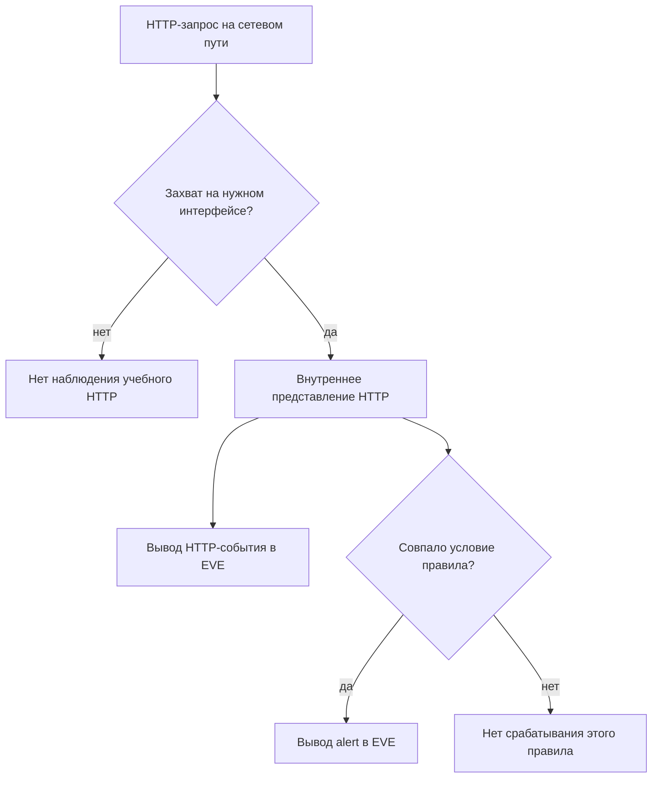

# Лабораторная работа №10 — Процесс работает — обнаружение работает?

<div class="chapter-lead">
<p>В ЛР №8 вы отличали сообщение <code>drop</code> от фактического сетевого предотвращения; в ЛР №9 — изменение файла правила от изменения работающего движка. Теперь выясним, почему даже сообщение <strong>Engine started</strong> не доказывает, что нужный HTTP-запрос попал в анализ, был проверен подходящей сигнатурой и появился в EVE.</p>
</div>

Используются две прежние VM: `idps-client` (`10.13.37.10`) и `idps-server` (`10.13.37.20`), действующий `idps-lab-web.service` на TCP/8080, установленная Suricata 8. Новых VM, сервисов, пакетов или средств обнаружения не добавляем. Это **пассивный IDS-эксперимент**; конфигурация firewall и существующий HTTP-сервис не меняются.

[Скачать пакет ЛР №10 v0.3](../../assets/downloads/idps-lab10-bundle-v0.3.zip){ .md-button .md-button--primary }
[SHA-256](../../assets/downloads/idps-lab10-bundle-v0.3.zip.sha256){ .md-button }

!!! note "Контроль целостности"
    Поместите ZIP и `.sha256` рядом, выполните `sha256sum -c idps-lab10-bundle-v0.3.zip.sha256` и `unzip -l idps-lab10-bundle-v0.3.zip`. Проверка обнаруживает несовпадение с опубликованным пакетом, но не заменяет независимую проверку происхождения.

!!! warning "Сначала завершите предыдущие эксперименты"
    Suricata ЛР №9 должна быть остановлена; таблица `inet spvo_lab08_ips` должна отсутствовать после штатной очистки ЛР №8. Нельзя одновременно запускать другую Suricata над этими интерфейсами или применять эксперименты на рабочей сети. В этой лабораторной выполняются **четыре отдельных запуска Suricata**, а не повторный `ruleset-reload-rules`: состояние интерфейса захвата задаётся при запуске. До следующего этапа требуется остановить предыдущий процесс через `Ctrl+C`.

## Исследовательский вопрос

Если Suricata успешно запущена, а HTTP-сервис отвечает, **почему ожидаемого оповещения может не быть?** Студент должен различить:

- **Факт обмена:** приложение действительно обработало запрос, что подтверждает HTTP-ответ клиента.
- **Наблюдаемость:** именно эта Suricata видела и разобрала нужный HTTP на выбранном интерфейсе, что подтверждает соответствующая запись `event_type: http` в EVE.
- **Срабатывание условия:** для того же `flow_id` есть `alert` с нужным `SID`, а не просто похожая строка в журнале.
- **Доставка результата:** событие найдено в файле `eve.json` конкретного прогона, а не в старом каталоге или выводе другой программы.



Запись HTTP в EVE — выход журналирования, а не вход детектора. Обе ветви используют внутреннее представление HTTP. Если выход журналов неполон, по отсутствующей записи нельзя автоматически судить о внутреннем состоянии движка.

**Перед началом** заполните прогноз в `report/lab10-report.md`. Не переписывайте прогноз как наблюдённый результат.

## 1. Четыре состояния одного учебного пути

Мы контролируем только два параметра: интерфейс, который слушает Suricata, и содержимое загруженного правила. Сам HTTP-сервис и отправляемые запросы не меняют смысл.

| Стадия | Где слушает Suricata | Какое правило загружено | Ожидаемые HTTP в EVE | Ожидаемый alert positive |
|---|---|---|---|---|
| `baseline` | `LAB_IFACE` | `observe.rules` | 2 | да |
| `blind` | **`NAT_IFACE`**, вне Host-Only пути | `observe.rules` | 0 для учебных URI | нет |
| `mismatch` | `LAB_IFACE` | `mismatch.rules` | 2 | нет |
| `restore` | `LAB_IFACE` | `observe.rules` | 2 | да |

В **каждой** стадии клиент выполняет два запроса: положительный `/LAB10-OBSERVE` и отрицательный `/LAB10-NORMAL`, каждый с метками `lab10_phase` и `lab10_case`. Ожидаются HTTP 200 и `path=...` для обоих: Suricata не блокирует трафик. Получается **8 реальных HTTP-запросов**, распределённых по четырём независимым запускам движка.

Сигнатура `observe.rules`:

```suricata
alert http 10.13.37.10 any -> 10.13.37.20 8080 (msg:"LAB10 controlled HTTP marker observed"; flow:established,to_server; http.uri; content:"/LAB10-OBSERVE"; sid:1000010; rev:1;)
```

`mismatch.rules` использует тот же SID `1000010`, но `rev:2` и `content:"/LAB10-NOT-SENT";`. Такой URI клиент не отправляет. Оба ruleset специально запускаются **по отдельности** через `-S`; никакой коллизии двух правил в работающем движке нет.

Положительный запрос здесь — **учебный маркер для проверки обнаружения**, а не настоящая атака. Это было установлено ещё в ЛР №6; не выдавайте `TP` за доказанную компрометацию.

## 2. Подготовьте прежние VM

Перед началом сохраните предыдущие результаты. На **обеих** VM в домашнем каталоге (каталога `idps-lab10-bundle-v0.3` ещё не должно быть):

```bash
cd ~
test ! -e idps-lab10-bundle-v0.3 && unzip idps-lab10-bundle-v0.3.zip
cd idps-lab10-bundle-v0.3
```

Используются те же три окна, что в ЛР №9:

| Окно | Назначение |
|---|---|
| `idps-server` SSH 1 | одна Suricata в foreground на время **одной** стадии |
| `idps-server` SSH 2 | preflight, проверка правил и анализ EVE между стадиями |
| `idps-client` терминал | два контролируемых HTTP-запроса каждой стадии |

На сервере в SSH 2:

```bash
sudo systemctl is-active idps-lab-web.service
bash server/preflight.sh
```

Ожидаются `active` и `PREFLIGHT_OK LAB_IFACE=... NAT_IFACE=...`. Preflight находит LAB-интерфейс по `10.13.37.20`, отдельный интерфейс с маршрутом по умолчанию (`NAT_IFACE`), проверяет маршрут к клиенту, исходный HTTP-ответ, оба файла правил через настоящую `suricata -T`, отсутствие прежнего процесса Suricata и остаточной таблицы ЛР №8. **Никаких изменений системной конфигурации preflight не выполняет.**

Если отдельного NAT-интерфейса нет, нельзя просто назвать второй случай `blind`: условие опыта невыполнимо, а доказательства отсутствуют. Зафиксируйте ограничение и не создавайте дополнительные интерфейсы по собственной инициативе.

Скрипты потребуют доступ `sudo` и Python 3, уже используемый на стенде. Не трактуйте отказ чтения состояния `nftables` как отсутствие таблицы. Если `nft` недоступен, перед продолжением отдельно подтвердите штатное завершение ЛР №8.

## 3. Baseline — рабочий путь обнаружения

На `idps-server`, SSH 1:

```bash
cd ~/idps-lab10-bundle-v0.3
bash server/run-stage.sh baseline
```

После `Engine started.` на клиенте:

```bash
cd ~/idps-lab10-bundle-v0.3
bash client/send-pair.sh baseline
```

В терминале клиента должны появиться два подтверждения `HTTP=200`. Вернитесь в серверный SSH 1 и остановите Suricata через **`Ctrl+C`**, дождавшись полного завершения. В `evidence/server/baseline/` останутся **реальные файлы** этого запуска, включая `eve.json`, `console.log`, копию загруженного правила `active.rules` и `stage.json`. В JSON фиксируются интерфейс, команда, PID, версия, хеши конфигурации/правила, начало и окончание процесса. Это локальная запись процедуры сбора, а не независимое удостоверение происхождения событий. Если процесс завершился с ошибкой, сохраните данные для диагностики; такой этап не считается успешно принятым. Не переиспользуйте файлы ЛР №9.

Проверьте HTTP-события и alert:

```bash
cd ~/idps-lab10-bundle-v0.3
sudo jq -c 'select(.event_type=="http" and (.http.url // "" | contains("lab10_phase=baseline"))) | {flow_id,url:.http.url,src_ip,dest_ip}' evidence/server/baseline/eve.json
sudo jq -c 'select(.event_type=="alert" and .alert.signature_id==1000010) | {flow_id,sid:.alert.signature_id,action:.alert.action}' evidence/server/baseline/eve.json
```

Ожидаются два `http` и один alert для положительного запроса. `flow_id` должен связывать alert именно с положительным запросом. Если клиент получил 200, но HTTP в EVE нет, не переходите к следующему этапу как будто всё успешно: причина может находиться в интерфейсе, захвате или настройках EVE.

## 4. Blind — работающий сенсор не видит учебный путь

В серверном SSH 1:

```bash
bash server/run-stage.sh blind
```

Скрипт выберет **`NAT_IFACE`**, интерфейс маршрута по умолчанию, а не Host-Only интерфейс `10.13.37.20`. Будет загружено **то же самое** правило `observe.rules`. После сообщения `Engine started.` на клиенте:

```bash
bash client/send-pair.sh blind
```

Ожидайте **два HTTP 200**: веб-сервис работает независимо от того, какой интерфейс выбрала пассивная Suricata. Завершите Suricata через `Ctrl+C`. В файле `evidence/server/blind/stage.txt` будет записано, какой интерфейс действительно использовался. В `eve.json` должны присутствовать статистические события `stats` с временной меткой и положительным `stats.uptime`, но **наших HTTP URI и соответствующего alert быть не должно**. Дождитесь минимум двух интервалов записи статистики, заданных текущей конфигурацией, прежде чем остановить процесс. Если EVE пуст или статистика не записывается, анализатор остановит приёмку: проверьте существующие настройки `stats`/EVE и журнал запуска. Не подменяйте отсутствие записи доказательством слепой зоны. Статистика подтверждает лишь активность журналирования; выбранный интерфейс проверяйте по `stage.txt`, команде запуска и фактическому маршруту.

Это **не корректный TN** и не доказанная ошибка содержания сигнатуры. У нас отсутствует свидетельство, что конкретный запрос достиг анализатора. Сопоставьте вывод `ip -4 route get 10.13.37.10` из preflight с выбранной интерфейсной картой.

## 5. Mismatch — запрос виден, правило не соответствует ему

В SSH 1 сервера:

```bash
bash server/run-stage.sh mismatch
```

Теперь Suricata снова слушает `LAB_IFACE`, но применяет `mismatch.rules` с другим `content`. После `Engine started.` на клиенте:

```bash
bash client/send-pair.sh mismatch
```

Остановите Suricata. В `evidence/server/mismatch/eve.json` ожидаются **два подтверждённых HTTP-события**, но ни одного совпадения с SID `1000010`. Это принципиально иной результат, чем `blind`: запросы были доступны детектору на выбранном представлении, но тестовый положительный URI **не удовлетворяет загруженному правилу**.

Относительно заранее заданного положительного учебного эталона это пропуск условия (**FN** в данной ограниченной модели). Отсутствие alert здесь обосновано только потому, что входное HTTP-событие независимо найдено в EVE и есть контрольный ответ веб-сервиса.

## 6. Restore — воспроизводимое восстановление

В серверном SSH 1:

```bash
bash server/run-stage.sh restore
```

Возвращены исходный LAB-интерфейс и `observe.rules`. После `Engine started.` на клиенте:

```bash
bash client/send-pair.sh restore
```

После двух успешных HTTP-ответов завершите Suricata. Ожидаются два HTTP-события и alert для положительного маркера. Теперь мы имеем полный цикл: проверенное исходное состояние → слепая зона → неверный критерий → восстановление. Обратите внимание: **все четыре запуска независимы**, поэтому это не испытание непрерывности обнаружения при переключении интерфейса и не тест zero-downtime reload.

## 7. Соберите единую матрицу доказательств

На сервере в SSH 2:

```bash
cd ~/idps-lab10-bundle-v0.3
sudo python3 tools/analyze-visibility.py
```

Скрипт проверяет метаданные завершения, хеш сохранённого правила, временные границы и предоставленные файлы EVE каждой стадии; их происхождение подтверждает процедура сбора. Он находит HTTP по точным URI и адресам, затем связывает alert по `flow_id` + `tx_id`. Проверяются точный URI, метод GET, HTTP 200, адреса/порт/протокол, редакция и действие alert; повторные и противоречащие записи не считаются успехом. В `blind` он не превращает отсутствие входного события в TN. В `mismatch` отсутствие alert проверяется только при наличии обоих HTTP. На выходе ожидается `EVE_MATRIX_OK`; если вывод `CHECK_FAILED`, скрипт объяснит конкретное расхождение, а не подставит ожидаемые данные. Посмотрите также по каждому прогону `stats.log` и доступные события `event_type: stats` — это эксплуатационные наблюдения, **но один нулевой счётчик потерь не доказывает отсутствие потерь по всему сетевому пути**.

Эталон для отчёта:

| Стадия | HTTP клиента | HTTP Suricata | Alert positive | Интерпретация |
|---|---|---|---|---|
| baseline | оба HTTP 200 | 2 | да | рабочее состояние в данном тесте |
| blind | оба HTTP 200 | нет наших URI | нет | выбран не тот интерфейс — **нет доказанной оценки условия** |
| mismatch | оба HTTP 200 | 2 | нет | наблюдение есть, сигнатура не совпала |
| restore | оба HTTP 200 | 2 | да | рабочая возможность восстановлена |

Это ожидаемые значения, **не реальные результаты до выполнения на VM**.

## 8. Отчёт, диагностика и границы вывода

Заполните `report/lab10-report.md`. Приложите восемь ответов клиента с заголовками и файлами `.meta`, четыре комплекта `stage.txt`/`stage.json`/`console.log`/`active.rules`, отдельные EVE, ручную выборку через `jq`, результат анализатора и объяснение каждой стадии. Для повторного опыта используйте **новый родительский каталог**, например `unzip idps-lab10-bundle-v0.3.zip -d lab10-attempt-02`, затем работайте из `lab10-attempt-02/idps-lab10-bundle-v0.3`. Повторная распаковка поверх прежнего каталога не очищает старые evidence и не создаёт независимый опыт. Не удаляйте их ради повторной попытки.

| Симптом | Что нужно проверить |
|---|---|
| Preflight не проходит | работает ли HTTP; нет ли предыдущей Suricata; есть ли отдельный NAT; не осталась ли nft-таблица ЛР №8 |
| `Engine started.` отсутствует | ошибки запуска Suricata, путь правил, интерфейс и права захвата |
| HTTP клиента не 200 | состояние *существующего* веб-сервиса; без HTTP нельзя оценить детектор |
| Baseline HTTP EVE отсутствует | `LAB_IFACE`, данные интерфейса, настройка EVE, двусторонность потока |
| Blind неожиданно видит наши HTTP | фактические маршруты, конфигурация интерфейсов, зеркалирование/бриджинг; не объявляйте прогноз правильным |
| Mismatch всё же даёт alert | действительно ли загружен `mismatch.rules`, какой `content`, не смешаны ли каталоги |
| Анализатор нашёл неполные данные | не считать отсутствие alert TN или доказательством работы; изучить настоящий `eve.json` |
| В одной стадии создано два разных прогона | зафиксировать границу доказательств; новый опыт проводить в новом каталоге распаковки |

**Вопрос для заключения:** какие минимальные эксплуатационные проверки обеспечат уверенность, что IDS после очередного обновления действительно анализирует нужный сетевой путь — не только что её процесс существует?

Технические источники:

- [Suricata 8.0.7 — EVE JSON Format](https://docs.suricata.io/en/suricata-8.0.7/output/eve/eve-json-format.html) — структура HTTP, alert, `flow_id` и статистических событий.
- [Suricata 8.0.7 — EVE JSON Output](https://docs.suricata.io/en/suricata-8.0.7/output/eve/eve-json-output.html) — конфигурация и ограничения вывода.

Оформление отчёта сохраняет привычный формат: прогноз, выполненные действия, наблюдения и границы вывода. Новая балльная шкала для этой работы не вводится.

**Итог ЛР №10:** работоспособность процесса, получение правильного трафика, протокольный разбор, применение нужного правила и наличие результата в EVE — разные уровни, которые нельзя заменять друг другом.

## Сохранение артефактов и аналитическое заключение

После остановки сбора, до очистки стенда, сохраните исходные журналы. На клиенте выполните `python3 tools/seal-evidence.py`, на сервере — `sudo python3 tools/seal-evidence.py` (журналы могут принадлежать root): он создаст `evidence-manifest.json` с именем узла, временем фиксации и SHA-256 файлов `evidence/` и `server/`. Это фиксация полученных байтов, не доказательство их истинности или времени события. Манифест не перезаписывается; оригиналы храните отдельно от рабочих копий. В отчёте укажите начало/конец опыта, часовой пояс обеих VM, известное расхождение часов, версию Suricata (`suricata -V`), источник и команды сбора. Хеш пакета не заменяет хеши ваших результатов.

Закончите отчёт пятью короткими пунктами:

1. Наблюдаемый факт со ссылкой на файл и запись.
2. Основное объяснение и хотя бы одна альтернатива.
3. Какая проверка различает эти объяснения.
4. Решение сейчас: продолжить диагностику, принять изменение, откатить либо передать на дополнительный анализ — с основанием.
5. Что осталось неизвестным и какое свидетельство изменит решение.

Не объявляйте инцидент по одному учебному маркеру. Отсутствие доказательств компрометации не освобождает от решения о неисправном наблюдении или изменении защиты.

## Самостоятельный разбор: три похожих отсутствия alert

Это отдельные **синтетические описания ситуаций**, не журналы вашего стенда. Ответьте без повторного запуска VM. Для каждой ситуации составьте пять пунктов аналитического заключения из предыдущего раздела. Решения должны опираться на доступные факты; разрешён ответ «причину пока установить нельзя» с конкретным следующим действием.

| Ситуация | Доступные факты |
|---|---|
| R17 | Клиент получил HTTP 200. EVE пуст. Сохранилась строка команды запуска на LAB-интерфейсе, но нет журнала завершения и статистики. |
| R42 | В EVE есть HTTP и stats. HTTP URL `/api/export`, status 200. Единственное правило ищет `/admin/export`; alert нет. Назначение запроса и права пользователя неизвестны. |
| R63 | Для одного flow_id: HTTP tx_id=0 — `/health`, HTTP tx_id=1 — `/api/export`; alert связан с tx_id=1. Оператор связал alert с `/health`, потому что flow_id совпадает. |

Для R17 укажите, что проверит дежурный SOC и с какими данными передаст проблему инженеру сенсора. Для R42 разделите вопрос о покрытии правила, гипотезу поиска похожей активности и вопрос о наличии уязвимости: какой из них разрешают имеющиеся данные? Для R63 исправьте связь событий и укажите, как сохранить исходные артефакты, чтобы другой аналитик мог проверить исправление.

Во всех случаях ответьте: достаточно ли оснований для ограничения доступа к сервису, какие последствия такого действия нужно учесть и какие данные следует сохранить заранее? Это упражнение на обоснование решения, а не требование блокировать сервис.

В этой работе отдельный вызов `curl` создаёт отдельный поток. В общем случае один поток содержит несколько HTTP-транзакций: `flow_id` связывает поток, `tx_id` уточняет транзакцию внутри него. Эти идентификаторы рассматриваются вместе с источником и границами прогона; они не являются универсальными ключами между разными сенсорами. Если требуемое поле не записано, не подставляйте его вручную — зафиксируйте ограничение и проверьте конфигурацию вывода.
