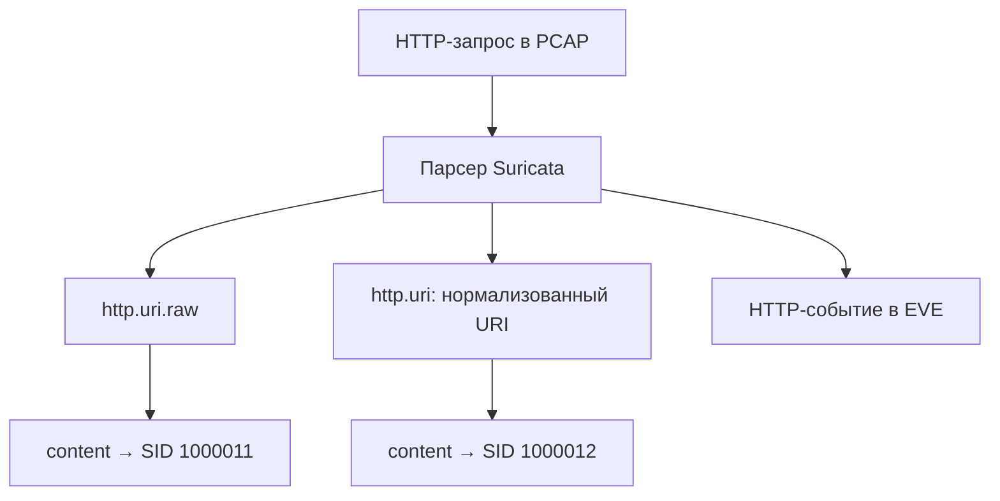

# Лабораторная работа №11 — Один URI, разные представления

<div class="chapter-lead">
<p>В ЛР №10 вы проверили путь от сетевого наблюдения до оповещения. Теперь считаем, что запрос действительно попал в анализ, и задаём следующий вопрос: <strong>какое представление запроса проверяет правило?</strong> Одинаковый <code>content</code> может давать разные результаты в исходном и нормализованном URI.</p>
</div>

Используем прежние `idps-client` (`10.13.37.10`) и `idps-server` (`10.13.37.20`), Suricata 8 и уже установленный `idps-lab-web.service` на TCP/8080 из ЛР №5. Сеть, HTTP-сервис и системную конфигурацию не меняем. Получаем **один настоящий PCAP**, затем анализируем его offline. Новых VM, служб и пакетов не требуется.

[Скачать пакет ЛР №11 v0.1](../../assets/downloads/idps-lab11-bundle-v0.1.zip){ .md-button .md-button--primary }
[SHA-256](../../assets/downloads/idps-lab11-bundle-v0.1.zip.sha256){ .md-button }

Сохраните оба файла рядом, проверьте `sha256sum -c idps-lab11-bundle-v0.1.zip.sha256` и просмотрите `unzip -l idps-lab11-bundle-v0.1.zip`. Контрольная сумма проверяет соответствие пакету; она не является независимым подтверждением происхождения.

## 1. Что именно сравниваем

**Request-target** — часть первой строки HTTP-запроса между методом и версией протокола. В наших запросах это путь с параметром, например `/lab11-marker?lab11_case=A`.

**Percent-encoding** — запись байта через `%` и две шестнадцатеричные цифры. В этой работе `%6d` представляет ASCII-байт буквы `m`. Кодирование не является шифрованием и само по себе не свидетельствует об атаке.

**Буфер правила** — представление данных, к которому применяется последующее условие. `http.uri.raw` проверяет URI без нормализации этого буфера; `http.uri` — нормализованный URI. Нормализация выполняется парсером Suricata и зависит от его настроек. Она не изменяет сохранённые байты PCAP и не означает, что приложение интерпретирует запрос точно так же.

Сравним три независимых наблюдения:

| Представление | Где посмотреть | Какой вопрос разрешает |
|---|---|---|
| Отправленная первая строка и заголовки | `*-request.bin` и клиентское направление PCAP | Что клиент подготовил и что видно на точке захвата? |
| Ответ прежнего HTTP-сервиса | `*-response.bin`, строка `path=...` | Какую строку запроса отразил этот учебный обработчик? |
| Результаты проверки двух буферов | Два SID в EVE, связанные с HTTP-транзакцией | В каком буфере совпало одинаковое условие? |



`http.url` в EVE — журналируемое поле. Оно не является одновременным дампом двух внутренних буферов. Различие проверяем **результатами правил на одном входном трафике**, а исходные байты сверяем с PCAP.

## 2. Четыре запроса и прогноз

Все пути — безопасные учебные маркеры. Они не содержат эксплойтов. Старый сервис возвращает текст с `path=...`; он не выдаёт здесь реальные документы и не доказывает существование ресурса с таким именем.

| Проба | Request-target | Что меняется |
|---|---|---|
| A | `/lab11-marker?lab11_case=A` | Буквальная строка маркера |
| B | `/lab11-%6darker?lab11_case=B` | Только буква `m` записана как `%6d` |
| C | `/lab11-normal?lab11_case=C` | Отрицательная контрольная проба |
| D | `/lab11-marker-extra?lab11_case=D` | Маркер присутствует как часть более длинного пути |

Параметр `lab11_case` нужен для сопоставления записей, а не является признаком вредоносности. Каждый запрос отправляется через отдельное TCP-соединение.

Полный запрос B, кроме отображения разделителей строк:

```http
GET /lab11-%6darker?lab11_case=B HTTP/1.1
Host: 10.13.37.20:8080
User-Agent: SPVO-LAB11
Connection: close

```

В файле отправки строки разделяются байтами `\r\n`, после заголовков идёт пустая строка. Тела у запроса нет. Скрипт использует стандартный Python socket, чтобы отправить именно эти байты без дополнительной обработки URI браузером.

**До запуска** заполните прогноз в `report/lab11-report.md`: для каждой пробы предположите срабатывание обоих правил и строку `path=` в ответе. В частности, решите: означает ли `content` равенство всего пути?

## 3. Два правила с одинаковым условием

В `server/lab11.rules` находятся ровно два правила:

```suricata
alert http 10.13.37.10 any -> 10.13.37.20 8080 (msg:"LAB11 raw URI marker"; flow:established,to_server; http.uri.raw; content:"/lab11-marker"; sid:1000011; rev:1;)
alert http 10.13.37.10 any -> 10.13.37.20 8080 (msg:"LAB11 normalized URI marker"; flow:established,to_server; http.uri; content:"/lab11-marker"; sid:1000012; rev:1;)
```

Адреса, направление, протокол и `content` одинаковы. Существенное различие — выбранный буфер. SID и msg позволяют различить результаты; `rev:1` фиксирует редакцию каждого правила. Оба правила одновременно загружаются через `-S`; остальные правила из YAML не добавляются к этому набору.

В A ожидаем совпадение в обоих буферах. В B исходный URI содержит `%6d`, а не буквальную `m`; при обычном декодировании этой последовательности нормализованный буфер содержит `/lab11-marker`. В C искомой строки нет. В D искомая строка присутствует как подстрока — условие не ограничено равенством полного пути.

Это **прогноз для проверки на вашем стенде**, а не готовый результат. При расхождении сначала проверьте реальные байты, загруженное правило и настройки HTTP-парсера. Не изменяйте журналы или конфигурацию ради совпадения с таблицей.

## 4. Подготовьте существующий стенд

Завершите ЛР №10: её Suricata должна быть остановлена. Если выполняли дополнительный IPS-эксперимент прежней редакции ЛР №8, его временная таблица должна быть удалена штатно. Новая ЛР №8 её не создаёт. Не останавливайте HTTP-сервис.

На обеих VM распакуйте пакет в домашнем каталоге, если одноимённого каталога ещё нет:

```bash
cd ~
test ! -e idps-lab11-bundle-v0.1 && unzip idps-lab11-bundle-v0.1.zip
cd idps-lab11-bundle-v0.1
```

Если каталог уже существует, сохраните результаты и используйте новый родительский каталог, например `unzip idps-lab11-bundle-v0.1.zip -d lab11-attempt-02`. Не распаковывайте поверх старых доказательств.

На сервере:

```bash
sudo systemctl is-active idps-lab-web.service
pgrep -a -x suricata
sudo nft list tables
curl --noproxy '*' -fsS 'http://10.13.37.20:8080/LAB11-PREFLIGHT'
suricata -V
```

Ожидаются `active`, отсутствие прежнего процесса Suricata и таблицы `spvo_lab08_ips`, ответ с `path=/LAB11-PREFLIGHT`. Отсутствие вывода `pgrep` с кодом 1 означает отсутствие найденного процесса; ошибка выполнения команды или отказ `sudo` не подтверждают чистоту стенда. Если `nft` отсутствует, отдельно проверьте, что этап IPS действительно был штатно завершён.

На каждой VM выполните `date -Is` и зафиксируйте часовой пояс/известное расхождение часов в отчёте. Не переносите старый PCAP из другой работы: запросы №11 должны быть получены в этом опыте.

## 5. Получите один PCAP

На сервере откройте два терминала. В первом из каталога пакета:

```bash
LAB_IFACE=$(ip -o -4 addr show | awk '$4 ~ /^10[.]13[.]37[.]20\// {print $2; exit}')
printf 'LAB_IFACE=%s\n' "$LAB_IFACE"
ip -4 route get 10.13.37.10
```

Убедитесь, что найден правильный Host-Only интерфейс и маршрут к клиенту проходит через него. Затем:

```bash
mkdir -p evidence
mkdir evidence/capture && sudo tcpdump -i "$LAB_IFACE" -nn -s 0 -U \
  -w "$PWD/evidence/capture/requests.pcap" \
  'host 10.13.37.10 and host 10.13.37.20 and tcp port 8080'
```

`mkdir evidence/capture` намеренно выполняется без `-p`: существующий каталог останавливает повторный запуск, чтобы прежний PCAP не был перезаписан. После сообщения `listening on ...` переходите на клиент. Не отправляйте другие запросы, пока идёт этот захват.

На клиенте из каталога пакета:

```bash
python3 client/send-probes.py
```

Ожидаются четыре строки `CASE=A…D HTTP=200`. Скрипт привязывает исходящее соединение к `10.13.37.10`, поэтому запуск на другой VM завершится ошибкой. В `evidence/client/` сохраняются запросы, ответы и метаданные времени/адресов. При ошибке частичные данные сохраняются; это не считается завершённым опытом.

Когда клиент завершит работу, подождите несколько секунд и остановите **только tcpdump** в первом терминале сервера через `Ctrl+C`. Запишите итоговые счётчики захвата в отчёт. При потерях или ошибке захвата не делайте вывод о полноте опыта.

Во втором терминале сервера:

```bash
cd ~/idps-lab11-bundle-v0.1
sudo tcpdump -nn -A -r evidence/capture/requests.pcap \
  'src host 10.13.37.10 and dst host 10.13.37.20 and tcp dst port 8080' \
  | tee evidence/capture/request-view.txt
```

Найдите строки GET для A–D. `tcpdump -A` показывает содержимое пакетов, а не выполняет полную сборку потока: если строка разделилась между сегментами, смотрите последовательность сегментов и сохранённый запрос клиента. Текстовый вывод дополняет PCAP, но не заменяет его.

На клиенте посмотрите B:

```bash
python3 -c 'from pathlib import Path; print(repr(Path("evidence/client/B-request.bin").read_bytes()))'
python3 -c 'from pathlib import Path; print(Path("evidence/client/B-response.bin").read_bytes().decode("utf-8", "replace"))'
```

Для прежнего сервиса строка `path=` сохраняет `%6d`. Это наблюдение о данном echo-обработчике; оно не означает, что любой веб-сервер одинаково обрабатывает кодирование или что два пути эквивалентны для реального приложения.

## 6. Проанализируйте PCAP двумя правилами

На сервере после остановки захвата:

```bash
sudo bash server/analyze-pcap.sh
```

Скрипт сохраняет копию правил, версию Suricata и хеши входов; проверяет конфигурацию/правила через `-T`; запускает offline-анализ через `-r`. Системный YAML, сетевые интерфейсы и служба HTTP не меняются. Старый каталог анализа не перезаписывается.

`-k none` применяется только при разборе PCAP этого виртуального стенда, где offloading может влиять на контрольные суммы захваченных пакетов. Это не рекомендация для рабочей IDS/IPS.

Дождитесь `REPLAY_COMPLETED`. При ошибке `-T` или replay сохраните журнал диагностики, не считайте анализ выполненным. В `evidence/analysis/` появятся `eve.json`, `active.rules`, `version.txt`, `inputs.sha256`, `command.txt`, журналы и отметки начала/завершения. Хеш YAML фиксирует именно этот файл; если ваша конфигурация подключает другие файлы, отдельно зафиксируйте их версии и содержимое.

## 7. Сопоставьте наблюдения

Сначала вручную выберите HTTP и два учебных SID:

```bash
sudo jq -c 'select(.event_type=="http") | {timestamp,flow_id,tx_id,src_ip,src_port,dest_ip,dest_port,http}' evidence/analysis/eve.json
sudo jq -c 'select(.event_type=="alert" and (.alert.signature_id==1000011 or .alert.signature_id==1000012)) | {timestamp,flow_id,tx_id,src_ip,src_port,dest_ip,dest_port,alert}' evidence/analysis/eve.json
```

Сопоставьте alert с HTTP по `flow_id` и `tx_id` в рамках этого файла и прогона; сверяйте адреса и порт клиента. Затем:

```bash
sudo python3 tools/eve-table.py evidence/analysis/eve.json
```

Скрипт выводит **наблюдаемое количество** alerts отдельно от совпадения с прогнозом. Он требует четыре HTTP GET/200, разные соединения, корректные поля, отсутствие повторов и посторонних учебных alerts. Неполный или противоречивый набор даёт `INCOMPLETE_OR_INVALID`, а не нули вместо пропущенных данных.

| Проба | Raw: SID 1000011, прогноз | Normalized: SID 1000012, прогноз | Что объясняет результат |
|---|---:|---:|---|
| A | 1 | 1 | Буквальная строка доступна обоим условиям |
| B | 0 | 1 | Декодирование `%6d` меняет представление для проверки |
| C | 0 | 0 | В наблюдаемом URI нет маркера |
| D | 1 | 1 | `content` ищет подстроку, а не равенство всего пути |

`DATA_COMPLETE` означает, что **предоставленные записи** удовлетворяют проверкам структуры/сопоставления. Оно не доказывает происхождение PCAP или отсутствие всех потерь. `FORECAST_MATCH` означает совпадение с этой узкой таблицей. `OBSERVED_DIFFERENCE` (код 2) означает, что данные приняты, но наблюдения отличаются от прогноза — сохраните результат и исследуйте причину.

HTTP 200 не доказывает успешность атаки. Отсутствие alert у raw-правила для B не означает, что «Suricata обойдена»: второе правило проверяет другое представление и может сработать. Выбор буфера определяется задачей правила.

## 8. Что сдаётся

Заполните `report/lab11-report.md`. Сохраните отдельно:

- на клиенте — четыре исходных запроса, четыре ответа и их метаданные;
- на сервере — PCAP, вывод просмотра, копию правил, EVE, параметры/журналы анализа;
- в отчёте — прогноз, фактическую матрицу, объяснение B и D, ограничения вывода.

После окончания сбора и анализа на клиенте:

```bash
find evidence -type f -print0 | sort -z | xargs -0 sha256sum > client-evidence.sha256
```

На сервере:

```bash
sudo find evidence -type f -print0 | sort -z | sudo xargs -0 sha256sum > server-evidence.sha256
```

Манифесты находятся вне `evidence/`, чтобы не хешировать сами себя. Хеши подтверждают совпадение сохранённых байтов между копиями; отдельно укажите источник, время, команды и автора сбора. Оригиналы не редактируйте. После работы tcpdump должен быть остановлен, offline-Suricata завершена, прежний HTTP-сервис доступен. Изменений firewall для отката нет.

## 9. Если результат отличается

| Симптом | Следующая проверка |
|---|---|
| Клиент не получил четыре 200 | Правильная VM, доступность прежнего сервиса, сохранённый ответ/ошибка; анализ пока неполон |
| B отправлен без `%6d` | Проверить `B-request.bin` и PCAP; не заменять скрипт браузером |
| HTTP есть не для всех проб | Время начала захвата, интерфейс, оба направления, packet loss, журнал replay и HTTP-логирование |
| B не дал normalized-alert | Байты запроса, `active.rules`, версия и применимый libhtp-профиль; сохранить несовпадение |
| B дал raw-alert | URI в PCAP, буфер в реально загруженном правиле, привязка alert к транзакции, смешение попыток |
| D дал два alerts | Это ожидаемо для поиска подстроки; объяснить, какое дополнительное условие нужно для точного пути |
| Анализатор сообщает повтор | Проверить, не отправлялась ли серия дважды; новый опыт — в новом каталоге |

## 10. Проверьте понимание

1. Почему `%6d` и `m` могут привести к разным результатам двух правил, хотя `content` одинаков?
2. Можно ли по одному `http.url` в EVE восстановить оба внутренних буфера? Какие дополнительные свидетельства использованы здесь?
3. Почему D срабатывает? Означает ли это автоматически false positive, если назначение правила не определено?
4. Что потребуется дополнительно, чтобы утверждать, что приложение обработало A и B как обращение к одному защищаемому ресурсу?

В заключении сформулируйте один подтверждённый факт, одну границу применимости и следующую проверку. Балльная шкала не добавляется: сохраняется привычный формат лабораторного отчёта.

**Итог:** условие правила имеет смысл только вместе с выбранным представлением данных. Нормализация сенсора, байты на сетевом пути и интерпретация приложения — связанные, но разные вещи.

Технические источники:

- [Suricata 8 — HTTP keywords](https://docs.suricata.io/en/suricata-8.0.7/rules/http-keywords.html#http-uri) — буферы URI.
- [Suricata 8 — настройки HTTP-парсера](https://docs.suricata.io/en/suricata-8.0.7/configuration/suricata-yaml.html#libhtp) — зависимость нормализации от конфигурации.
- [RFC 3986, раздел 2.1](https://www.rfc-editor.org/rfc/rfc3986#section-2.1) — percent-encoding.
