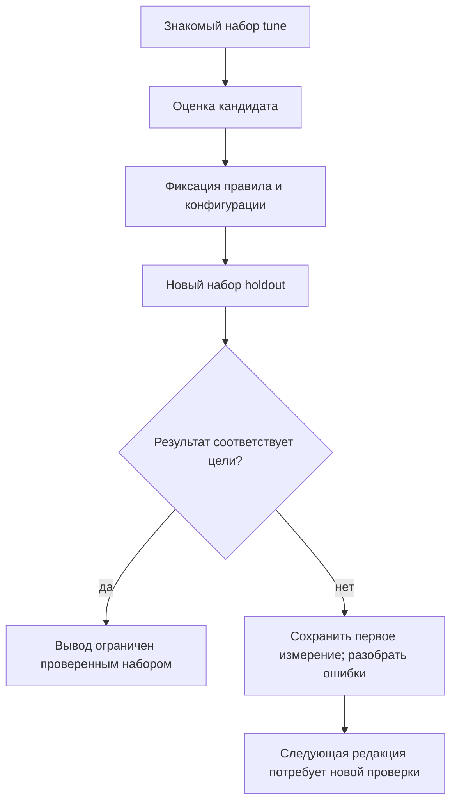

# Лабораторная работа №12 — Хороший результат — на каких данных?

<div class="chapter-lead">
<p>В ЛР №6 вы оценивали качество правила, в №11 — влияние выбранного представления HTTP. Теперь проверим, можно ли переносить хороший результат со знакомых примеров на новые. <strong>Одно правило, два разных набора запросов и отдельно сохранённый первый результат проверки.</strong></p>
</div>

Работа выполняется на прежних `idps-client` (`10.13.37.10`) и `idps-server` (`10.13.37.20`) с существующим HTTP-сервисом TCP/8080 из ЛР №5. Используются Python 3, tcpdump и Suricata 8. Новые VM, службы и пакеты не устанавливаем. Анализ PCAP — offline; фильтрацию трафика не включаем.

[Скачать пакет ЛР №12 v0.1](../../assets/downloads/idps-lab12-bundle-v0.1.zip){ .md-button .md-button--primary }
[SHA-256](../../assets/downloads/idps-lab12-bundle-v0.1.zip.sha256){ .md-button }

Перед распаковкой: `sha256sum -c idps-lab12-bundle-v0.1.zip.sha256` и `unzip -l idps-lab12-bundle-v0.1.zip`. Контрольная сумма проверяет соответствие опубликованным байтам, а не независимо удостоверяет происхождение.

## 1. Исследовательский вопрос

**Набор настройки (`tune`)** — примеры, которые использовали при выборе условия правила. Хорошая метрика на нём показывает соответствие этим примерам, но не гарантирует перенос на другие.

**Отложенный набор (`holdout`)** — другие примеры, которые анализируют после фиксации правила. Если сначала изучить их результаты и подстроить правило, этот набор становится частью настройки.

**Подгонка под примеры** — ситуация, когда условие опирается на случайную особенность знакомых запросов вместо требуемого признака. Это возможно и при ручном составлении сигнатуры, без машинного обучения.

В данной работе предоставлен готовый кандидат, имитирующий результат узкой настройки. Мы **не обучаем ML-модель** и не утверждаем, что здесь проводится статистически репрезентативное испытание. В основной части правило не редактируем: нужно оценить его переносимость.

!!! note "Граница независимости"
    Файлы публичного учебного пакета доступны для чтения. Не открывайте `data/holdout.json` и не запускайте `holdout` до фиксации правила. Это учебная процедура разделения данных, а не слепой экзамен и не криптографическая защита от просмотра. Если примеры уже видели, отметьте это в отчёте. Хеш фиксирует байты, но не доказывает отсутствие предварительного знакомства.



## 2. Сначала определите целевое событие

Положительный случай в этом упражнении — HTTP GET, у которого **весь путь до `?`** имеет вид:

```text
/lab12-review/item-XX
```

Здесь `XX` — ровно две ASCII-цифры `0–9`. После них путь заканчивается. Параметр `lab12_case` служит только для связи артефактов. Он не должен использоваться как признак положительного класса.

Остальные пути этого учебного сценария — отрицательные. Это **контракт учебного обнаружения**, а не классификация реальных атак. Все запросы безопасны; прежний сервис отражает путь в ответе, но не выполняет доступ к реальному документу.

Например, суффикс после двух цифр нарушает условие точного пути. Разметка определяется этим правилом задачи **до просмотра alerts**, а не наличием срабатывания или HTTP 200.

Единица оценки — один запрос. В каждой серии четыре запроса через четыре отдельных соединения. Один запрос не превращается в несколько TP из-за нескольких одинаковых строк alert.

## 3. Знакомые примеры и кандидат

Набор `tune`:

| Проба | Путь | Эталон |
|---|---|---|
| T1 | `/lab12-review/item-01` | Положительный |
| T2 | `/lab12-review/item-02` | Положительный |
| T3 | `/lab12-health/ping` | Отрицательный |
| T4 | `/lab12-normal` | Отрицательный |

Скрипт добавляет к каждому пути `?lab12_case=T1` и аналогичные метки.

Кандидат `server/candidate.rules`:

```suricata
alert http 10.13.37.10 any -> 10.13.37.20 8080 (msg:"LAB12 candidate after narrow tuning"; flow:established,to_server; http.uri; content:"/lab12-review/item-0"; sid:10000120; rev:1;)
```

В отличие от SID из №11 здесь используется отдельный SID `10000120`. В работе загружается только этот файл через `-S`.

До опыта ответьте:

- Что именно проверяет это `content`?
- Совпадает ли оно со всем определением положительного класса?
- Какие свойства пути оно вообще не проверяет?

Запишите прогноз только для `tune`. Для ещё не просмотренного `holdout` запишите гипотезу о переносимости и её основание, не выдумывая фактические метрики.

## 4. Подготовьте прежний стенд

Завершите захват/анализ №11; прежняя Suricata из live-экспериментов должна быть остановлена. Временная IPS-таблица №8 должна отсутствовать. Служба HTTP остаётся запущенной.

На обеих VM:

```bash
cd ~
test ! -e idps-lab12-bundle-v0.1 && unzip idps-lab12-bundle-v0.1.zip
cd idps-lab12-bundle-v0.1
```

Повторный опыт проводите в новом родительском каталоге, например после `unzip idps-lab12-bundle-v0.1.zip -d lab12-attempt-02`. Повторная распаковка поверх старых файлов не отделяет запуски.

На сервере:

```bash
sudo systemctl is-active idps-lab-web.service
pgrep -a -x suricata
sudo nft list tables
curl --noproxy '*' -fsS 'http://10.13.37.20:8080/LAB12-PREFLIGHT'
suricata -V
```

Проверьте `active`, отсутствие прежнего процесса и таблицы `spvo_lab08_ips`, ответ `path=/LAB12-PREFLIGHT`. Отказ sudo или ошибка чтения nft не равны отсутствию таблицы. Если `nft` недоступен, отдельно подтвердите штатное завершение IPS-опыта.

В отчёте зафиксируйте версии и вывод `date -Is` обеих VM, известное расхождение часов. Для эксперимента нужны два серверных терминала и клиентский терминал — как в №11.

## 5. Получите и оцените tune

В первом терминале сервера из каталога пакета:

```bash
LAB_IFACE=$(ip -o -4 addr show | awk '$4 ~ /^10[.]13[.]37[.]20\// {print $2; exit}')
printf 'LAB_IFACE=%s\n' "$LAB_IFACE"
ip -4 route get 10.13.37.10
```

Убедитесь, что найден Host-Only интерфейс и маршрут соответствует ему. Затем:

```bash
mkdir -p evidence
mkdir evidence/capture-tune && sudo tcpdump -i "$LAB_IFACE" -nn -s 0 -U \
  -w "$PWD/evidence/capture-tune/requests.pcap" \
  'host 10.13.37.10 and host 10.13.37.20 and tcp port 8080'
```

После `listening on ...` на клиенте:

```bash
python3 client/send-probes.py tune
```

Ожидаются четыре HTTP 200. Сохраняются точные запросы, ответы и метаданные в `evidence/client/tune/`. При ошибке сохраните частичные результаты, не считайте серию завершённой.

После окончания клиентской команды подождите несколько секунд и остановите tcpdump через `Ctrl+C`. Запишите счётчики захвата. Не включайте другой трафик в этот опыт.

Во втором терминале сервера:

```bash
cd ~/idps-lab12-bundle-v0.1
sudo bash server/replay.sh tune
sudo python3 tools/evaluate.py tune
```

Скрипт сначала проверяет правило через `-T`, затем запускает offline-анализ. Сохраняются копия правила, хеши PCAP/правила/конфигурации/набора, версия Suricata, команда и журналы. Существующий каталог результата не перезаписывается.

`-k none` применяется только к PCAP виртуального стенда с возможным влиянием offloading. Настройки рабочей IDS/IPS из этого не следуют.

Для данного кандидата на `tune` ожидаются T1/T2 с alert и T3/T4 без него. Подтвердите это реальным EVE. Если отсутствуют HTTP или даже ожидаемые контрольные alerts T1/T2, сначала проверьте наблюдаемость, загруженный файл и включённый вывод `alert` в EVE. Не переходите к оценке переносимости с неисправным путём журналирования.

## 6. Зафиксируйте правило до holdout

Сначала сохраните результат `tune` в отчёте. Затем на сервере:

```bash
sudo bash server/freeze.sh
```

В `evidence/frozen/` появятся `rule.rules`, `inputs.sha256` и время фиксации. Скрипт копирует **именно правило из завершённого анализа tune**, а не произвольную текущую редакцию исходного файла. Повторная фиксация поверх прежней запрещена.

Основная часть работы продолжается с этой редакцией. Не меняйте правило, разметку и системную конфигурацию между оценками. Хеши проверяют указанные файлы; если YAML использует дополнительные подключения, зафиксируйте их отдельно. Сравните версии Suricata обоих запусков.

Только теперь переходите к новому набору. Все его запросы остаются в разрешённой лабораторной сети и обслуживаются тем же echo-сервисом.

## 7. Получите первый результат holdout

В первом терминале сервера, где ранее задавали `LAB_IFACE`:

```bash
mkdir evidence/capture-holdout && sudo tcpdump -i "$LAB_IFACE" -nn -s 0 -U \
  -w "$PWD/evidence/capture-holdout/requests.pcap" \
  'host 10.13.37.10 and host 10.13.37.20 and tcp port 8080'
```

После начала захвата на клиенте:

```bash
python3 client/send-probes.py holdout
```

После четырёх ответов остановите tcpdump на сервере, сохранив счётчики. Во втором терминале сервера:

```bash
sudo bash server/replay.sh holdout
sudo python3 tools/evaluate.py holdout
```

Перед replay проверяются замороженные файлы и совпадение правила с использованным на tune. Один и тот же SID должен относиться к одной и той же редакции и условию, а не к двум незаметно разным правилам.

Теперь можно открыть состав набора:

```bash
python3 -m json.tool data/holdout.json
```

Сопоставьте каждую метку `positive` с определением целевого события из раздела 2. Анализатор также проверяет эту согласованность. Изменять эталон вслед за неудачным срабатыванием нельзя.

Первый результат — часть отчёта, даже если он хуже ожидаемого. Не заменяйте его повторным запуском уже исправленного правила.

## 8. Проверьте события и метрики

Пример ручной проверки на сервере:

```bash
sudo jq -c 'select(.event_type=="http") | {timestamp,flow_id,tx_id,src_port,http}' evidence/holdout/eve.json
sudo jq -c 'select(.event_type=="alert" and .alert.signature_id==10000120) | {timestamp,flow_id,tx_id,src_port,alert}' evidence/holdout/eve.json
sudo sha256sum evidence/tune/active.rules evidence/holdout/active.rules
```

Два хеша правил должны совпадать. Alert связывается с HTTP по `flow_id`, `tx_id` и порту клиента в рамках соответствующего прогона. Разметка берётся из описания сценария, а не из alert.

| Истинный класс | Alert есть | Alert отсутствует при подтверждённом наблюдении |
|---|---|---|
| Положительный | TP | FN |
| Отрицательный | FP | TN |

Для каждого набора посчитайте отдельно:

```text
precision = TP / (TP + FP)
recall    = TP / (TP + FN)
FPR       = FP / (FP + TN)
accuracy  = (TP + TN) / N
```

При нулевом знаменателе значение не определено: анализатор пишет `N/A`, а не 0 или 100%. `N` — четыре наблюдаемых запроса данной серии. При отсутствии хотя бы одного ожидаемого HTTP анализатор **не считает метрики для неполной серии** и выводит `INCOMPLETE_OR_INVALID`.

`EVALUATION_COMPLETE` означает завершение расчёта по предоставленным данным, а не хорошее качество правила. Код 0 возможен и при плохих метриках. Сверьте вычисления вручную с первичными событиями. Полнота выдачи alerts и происхождение файлов подтверждаются процедурой сбора, конфигурацией и журналами, а не одним статусом анализатора.

Восемь запросов — маленький намеренно составленный учебный набор. Проценты здесь описывают только его; они не оценивают вероятность обнаружения реальных атак во всей сети. Не объединяйте tune и holdout в одну «красивую» итоговую метрику, скрывающую различие этапов.

## 9. Разберите причину, затем предложите следующую редакцию

Для каждого FP/FN укажите:

1. Требование задачи и независимый истинный класс.
2. Фрагмент URI и конкретное условие, объясняющее результат.
3. Какое ограничение кандидата выявлено.
4. Какую логику следовало бы изменить и какие новые положительные/отрицательные/граничные примеры её проверят.

Здесь достаточно обоснованного предложения: основная измеряемая часть завершается **первой проверкой зафиксированного кандидата**. Не нужно вводить новый сервис, расширять сеть или добиваться нужных процентов дополнительными запусками.

Если самостоятельно проверяете новую редакцию, сохраните её отдельно с новой rev и новым каталогом результата. Повторно использованный holdout будет регрессионным набором, уже известным при разработке. Для нового вывода о переносимости потребуется другой, ещё не использованный набор. Штатный анализатор этой работы рассчитан на исходный SID/rev и не принимает произвольную новую редакцию автоматически.

## 10. Отчёт и завершение

Заполните `report/lab12-report.md`. Приложите:

- клиентские запросы, ответы и метаданные обеих серий;
- два PCAP и сведения о захвате;
- EVE, активные правила, замороженную копию, хеши и журналы;
- две отдельные матрицы, расчёты и объяснение расхождения;
- честную отметку, был ли holdout просмотрен до фиксации.

После завершения всех записей на клиенте:

```bash
find evidence -type f -print0 | sort -z | xargs -0 sha256sum > client-evidence.sha256
```

На сервере:

```bash
sudo find evidence -type f -print0 | sort -z | sudo xargs -0 sha256sum > server-evidence.sha256
```

Хеши сохраняются вне `evidence/`. Они фиксируют байты, но не заменяют описание источника, времени и способа получения. Оригиналы не редактируйте; повторные попытки храните отдельно. Убедитесь, что tcpdump остановлен, offline-Suricata завершена, прежний HTTP-сервис работает. Firewall в этой работе не менялся.

## Если опыт не складывается

| Наблюдение | Что проверить |
|---|---|
| Не все запросы получили 200 | Доступность существующего сервиса, клиентский адрес, сохранённую ошибку/ответ |
| Пропущен ожидаемый HTTP | Время захвата, интерфейс, оба направления, потери, журнал replay и HTTP-логирование |
| Tune не дал контрольные alerts | Реальное правило, SID/rev, настройки вывода alert, входной PCAP |
| Freeze или holdout сообщает изменённый хеш | Сохранить расхождение и сравнить файлы; не пересчитывать хеш ради обхода проверки |
| На holdout метрики упали | Сначала проверить доказательства; затем объяснить ошибки условием правила, не менять эталон |
| Правило изменили после просмотра holdout | Обозначить следующую работу как настройку/регрессию, сохранить первое измерение |

## Проверьте понимание

1. Почему идеальный результат на tune не подтверждает общее качество правила?
2. Почему хеш не делает публичный набор «слепым»?
3. Почему пропущенное HTTP-событие нельзя автоматически записать в FN или TN?
4. Чем повторная проверка исправленного правила на знакомом наборе отличается от проверки переносимости?
5. Какой результат этой работы можно сообщить руководителю без завышения уверенности?

**Итог:** качество относится к конкретной версии правила, заданной цели и конкретному набору. Сохранённое первое измерение и разделение настройки/проверки важнее красивого процента.

Связь с теорией: [эффективность обнаружения](../../course/08-effectiveness.md) и [жизненный цикл правил](../../course/10-operations-lifecycle.md).

Технические источники:

- [Suricata 8 — HTTP keywords](https://docs.suricata.io/en/suricata-8.0.7/rules/http-keywords.html) — условия над HTTP-буферами.
- [Suricata 8 — параметры запуска](https://docs.suricata.io/en/suricata-8.0.7/command-line-options.html) — проверка, отдельный ruleset и offline-анализ.
- [scikit-learn — data leakage](https://scikit-learn.org/stable/common_pitfalls.html#data-leakage) — принцип разделения данных. Здесь он применяется методически к ручной настройке правила; библиотека не используется.
