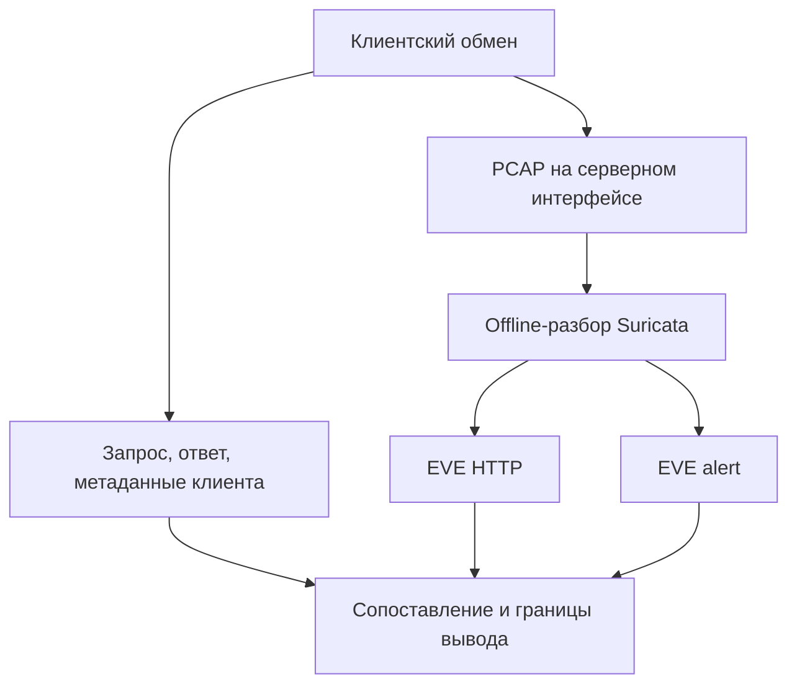

# Лабораторная работа №13 — От оповещения к проверяемому заключению

<div class="chapter-lead">
<p>В №11 вы сравнивали представления HTTP, в №12 — качество правила на разных примерах. Теперь задача аналитическая: <strong>какой запрос вызвал alert, что ответило приложение и какие выводы действительно поддерживаются артефактами?</strong> Результат работы — связанная временная шкала и короткое заключение для передачи следующему аналитику.</p>
</div>

Используем прежние VM `idps-client` (`10.13.37.10`) и `idps-server` (`10.13.37.20`), HTTP-сервис из ЛР №5 на TCP/8080, Python 3, tcpdump и Suricata 8. Новых VM, сервисов и пакетов не добавляем. Три безопасных запроса сохраняются в одном PCAP и анализируются offline. Никаких операций с реальными файлами пользователей или экспортом данных не выполняется.

[Скачать пакет ЛР №13 v0.1](../../assets/downloads/idps-lab13-bundle-v0.1.zip){ .md-button .md-button--primary }
[SHA-256](../../assets/downloads/idps-lab13-bundle-v0.1.zip.sha256){ .md-button }

Сохраните ZIP и checksum рядом, выполните `sha256sum -c idps-lab13-bundle-v0.1.zip.sha256` и `unzip -l idps-lab13-bundle-v0.1.zip`. Контрольная сумма проверяет соответствие опубликованным байтам, но не заменяет независимую проверку происхождения.

## 1. Исходное сообщение и исследовательский вопрос

Учебное исходное сообщение оператора:

> «Правило обнаружило export, клиент получил 200 — значит данные успешно выгрузили».

Это **гипотеза для проверки**, а не описание установленного инцидента. Вам нужно получить собственные артефакты, выяснить, какие факты стоят за этим сообщением, и исправить чрезмерно сильный вывод.

В этой работе прежний сервис возвращает текст с `path=...`. Он не реализует бизнес-операцию экспорта, авторизацию и доступ к документам. Название пути и текст сигнатуры не создают такую функциональность.

Перед опытом запишите в `report/lab13-report.md`:

- какие факты подтвердили бы именно сетевое обращение;
- что нужно дополнительно для подтверждения выполнения бизнес-операции;
- почему одинаковый SID у двух событий ещё не означает одинаковый запрос.

## 2. Какие свидетельства связаны, а какие независимы

| Артефакт | Что он показывает | Чего сам по себе не доказывает |
|---|---|---|
| Клиентские request/response и метаданные | Подготовленные байты, результат отправки/приёма, адреса и локальное время | Что все эти байты попали на выбранную точку захвата; права пользователя в приложении |
| PCAP сервера | Наблюдавшиеся на интерфейсе пакеты | Полноту всей сети или успешность бизнес-операции |
| EVE от offline-Suricata | Интерпретацию этого PCAP и совпадение условия правила | Второе независимое наблюдение сети или факт компрометации |



**PCAP и EVE связаны происхождением:** EVE получен из этого PCAP. Нельзя считать их двумя независимыми сенсорами. Клиентская запись создана в другой точке; её сопоставление полезно, но всё равно требует проверки идентификаторов, полноты и происхождения.

В offline-режиме время сетевого события и время запуска анализа — разные вещи. Не ставьте alert в конец временной шкалы только потому, что Suricata запущена после захвата.

## 3. Три обращения и одно правило

| Проба | Путь | Назначение |
|---|---|---|
| A | `/lab13/health` | Контрольный запрос без искомой подстроки |
| B | `/lab13/export` | Запрос с буквальным маркером |
| C | `/lab13/export-status` | Другой путь с той же подстрокой |

Клиент добавляет уникальный для попытки параметр `lab13_request=<идентификатор>-A` и аналогичные B/C. Это учебный идентификатор запроса (**request ID**): он позволяет отличить записи, но не является подписью и не удостоверяет отправителя. Каждый запрос использует отдельное TCP-соединение.

Правило `server/lab13.rules`:

```suricata
alert http 10.13.37.10 any -> 10.13.37.20 8080 (msg:"LAB13 export path marker observed"; flow:established,to_server; http.uri; content:"/lab13/export"; sid:10000130; rev:1;)
```

Вспомните №11: `content` ищет подстроку. Прогноз — отсутствие этого alert у A и срабатывание у B и C. Оба срабатывания относятся к условию правила; без определения задачи обнаружения нельзя автоматически объявить C ложным срабатыванием или B настоящей атакой.

## 4. Подготовьте прежний стенд

Завершите захват и offline-анализ №12. Прежние live-процессы Suricata должны быть остановлены, временная IPS-таблица №8 — удалена по той работе. HTTP-сервис продолжает работать.

На обеих VM:

```bash
cd ~
test ! -e idps-lab13-bundle-v0.1 && unzip idps-lab13-bundle-v0.1.zip
cd idps-lab13-bundle-v0.1
```

Повторную попытку проводите в новом родительском каталоге, например после `unzip idps-lab13-bundle-v0.1.zip -d lab13-attempt-02`. Не распаковывайте пакет поверх прежних артефактов.

На сервере:

```bash
sudo systemctl is-active idps-lab-web.service
pgrep -a -x suricata
sudo nft list tables
curl --noproxy '*' -fsS 'http://10.13.37.20:8080/LAB13-PREFLIGHT'
suricata -V
```

Проверьте `active`, отсутствие прежней Suricata и таблицы `spvo_lab08_ips`, ответ `path=/LAB13-PREFLIGHT`. Ошибка выполнения или отказ sudo не означают отсутствие процесса/таблицы. Если nft недоступен, отдельно подтвердите штатное завершение IPS-опыта.

На обеих VM сохраните в отчёте `date -Is`, часовой пояс и известное расхождение часов. Точное расхождение может быть неизвестно — так и укажите. Перевод записей в UTC устраняет различие часовых поясов, но **не исправляет неточные часы**. Не меняйте системное время посреди эксперимента.

## 5. Соберите реальные артефакты

В первом терминале сервера:

```bash
LAB_IFACE=$(ip -o -4 addr show | awk '$4 ~ /^10[.]13[.]37[.]20\// {print $2; exit}')
printf 'LAB_IFACE=%s\n' "$LAB_IFACE"
ip -4 route get 10.13.37.10
```

Убедитесь, что выбран Host-Only интерфейс и маршрут к клиенту соответствует ему. Из каталога пакета:

```bash
mkdir -p evidence
mkdir evidence/capture && sudo tcpdump -i "$LAB_IFACE" -nn -s 0 -U \
  -w "$PWD/evidence/capture/requests.pcap" \
  'host 10.13.37.10 and host 10.13.37.20 and tcp port 8080'
```

Создание каталога без `-p` не позволяет молча перезаписать прежний PCAP. После `listening on ...` на клиенте:

```bash
python3 client/send-probes.py
```

Должны завершиться три обмена с HTTP 200. Для каждого сохраняются `*-request.bin`, `*-response.bin`, `*-meta.json`. В метаданных есть request ID, адреса/порт соединения, время до соединения, после отправки и после приёма ответа. Эти отметки не являются точным временем каждого сетевого пакета.

Запрос сохраняется до попытки отправки. Поэтому одного `request.bin` недостаточно для утверждения «запрос доставлен»: проверяйте статус, ответ и PCAP. При ошибке частичные данные остаются для диагностики.

После окончания клиентской команды подождите несколько секунд, остановите tcpdump через `Ctrl+C` и запишите его счётчики. При потерях не утверждайте полноту захвата.

Во втором терминале сервера:

```bash
cd ~/idps-lab13-bundle-v0.1
sudo bash server/analyze-pcap.sh
```

Скрипт проверяет правило через `-T`, сохраняет копию и хеши входов, запускает offline-анализ. `-k none` предназначен только для PCAP этого виртуального стенда с возможным влиянием offloading. Системный YAML и сервисы не меняются.

Дождитесь `REPLAY_COMPLETED`. При ошибке остановитесь и сохраните диагностику. Не создавайте EVE вручную и не используйте файлы предыдущей работы.

## 6. Начните с исходного alert

На сервере:

```bash
sudo jq -c 'select(.event_type=="alert" and .alert.signature_id==10000130) | {timestamp,flow_id,tx_id,src_ip,src_port,dest_ip,dest_port,alert,http}' evidence/analysis/eve.json
```

Для каждого найденного alert выпишите SID/rev, действие, `flow_id`, `tx_id`, адреса и порт клиента. Затем:

```bash
sudo jq -c 'select(.event_type=="http") | {timestamp,flow_id,tx_id,src_ip,src_port,dest_ip,dest_port,http}' evidence/analysis/eve.json
```

Свяжите alert с **конкретной** HTTP-транзакцией. Не выбирайте ближайшую по времени запись и не используйте только одинаковый SID. В этой работе отдельные соединения упрощают проверку; в общем случае в одном flow может быть несколько HTTP-транзакций.

На клиенте изучите B и C:

```bash
python3 -m json.tool evidence/client/B-meta.json
python3 -m json.tool evidence/client/C-meta.json
python3 -c 'from pathlib import Path; print(Path("evidence/client/B-response.bin").read_bytes().decode("utf-8", "replace"))'
python3 -c 'from pathlib import Path; print(Path("evidence/client/C-response.bin").read_bytes().decode("utf-8", "replace"))'
```

Сопоставьте request ID и полный URI, адреса, порт клиента и отражённый `path=`. Ответы содержат служебный текст echo-обработчика. Имя `export` в строке пути не подтверждает выгрузку каких-либо данных.

## 7. Проверьте соответствующий обмен в PCAP

Выберите фактический порт клиента для B из метаданных и EVE. На сервере:

```bash
read -r -p 'Порт клиента для запроса B: ' CLIENT_PORT
sudo env TZ=UTC tcpdump -nn -tttt -A -r evidence/capture/requests.pcap \
  "tcp port 8080 and port $CLIENT_PORT"
```

Найдите запрос с тем же request ID, затем серверный ответ в обратном направлении. Повторите проверку для C. Зафиксируйте время и сетевые адреса обеих сторон.

`tcpdump -A` отображает отдельные пакеты; это не автоматическая сборка потока. Если HTTP разделён между сегментами, учитывайте их порядок и TCP sequence numbers. Не объявляйте содержимое отсутствующим только потому, что оно не поместилось в один пакет. Если по имеющимся артефактам обмен нельзя восстановить уверенно, отметьте ограничение.

Одинаковый порт сам по себе не является универсальным идентификатором: он может переиспользоваться. Здесь дополнительно сверяются адреса, протокол, границы захвата и request ID. В запросах нет NAT или промежуточного прокси; при другой архитектуре правила сопоставления потребовали бы пересмотра.

## 8. Проверьте сопоставление скриптом

Сначала выполните ручную проверку. Для автоматического сопоставления перенесите **копию** клиентских артефактов на сервер, сохранив оригиналы.

На клиенте из каталога пакета:

```bash
(cd evidence/client && sha256sum *.bin *.json > SHA256SUMS)
```

На сервере убедитесь, что целевого каталога ещё нет:

```bash
test ! -e evidence/client-copy
```

Если команда вернула ошибку, не копируйте поверх прежней попытки. На клиенте укажите реальное имя SSH-пользователя сервера:

```bash
read -r -p 'Имя SSH-пользователя idps-server: ' SERVER_USER
scp -r evidence/client "${SERVER_USER}@10.13.37.20:idps-lab13-bundle-v0.1/evidence/client-copy"
```

Для повторной распаковки измените только путь назначения на фактический каталог этой попытки. Не подставляйте имя VM вместо имени учётной записи. SSH уже используется в практикуме; новую службу для копирования не устанавливайте.

На сервере:

```bash
(cd evidence/client-copy && sha256sum -c SHA256SUMS)
sudo python3 tools/correlate.py evidence/client-copy evidence/analysis/eve.json
```

Скрипт сверяет сохранённый запрос и ответ, единый ID попытки, точный URI, адреса/порт, HTTP GET/200 и связь alert с транзакцией. Выдаёт номера строк EVE и исходные временные отметки. Он **не разбирает PCAP**, не удостоверяет происхождение файлов и не принимает решение об инциденте.

`LINKED_RECORDS` означает согласованность предоставленных клиентских записей и EVE в пределах проверок. `INCOMPLETE_OR_INVALID` означает пробел или противоречие; `OBSERVED_DIFFERENCE` — отличие картины alerts от прогноза. Ни один из этих статусов не заменяет ручную проверку PCAP и аналитическое заключение.

## 9. Составьте временную шкалу и проверьте гипотезы

Для B и C заполните в отчёте таблицу: источник, исходное время с часовым поясом, наблюдаемый факт, идентификаторы, ссылка на файл/строку, ограничение.

Сохраните порядок событий **внутри каждого источника**. Если часы узлов расходятся или точная поправка неизвестна, не создавайте искусственно точную общую шкалу. Связь request ID и соединения может быть установлена без утверждения, что разница двух часов равна сетевой задержке.

Проверьте следующие утверждения:

| Утверждение | Что потребуется проверить |
|---|---|
| Клиент отправил конкретный HTTP-запрос | Результат send, исходные байты и наблюдение на точке захвата |
| Приложение вернуло ответ на этот запрос | Клиентский ответ, обратное направление потока, request ID/отражённый путь |
| Правило выделило этот запрос | SID/rev и связь alert с HTTP по flow_id/tx_id |
| Выполнена выгрузка защищаемых данных | Содержимое ответа и независимые сведения о бизнес-операции, правах и данных |
| Произошёл инцидент безопасности | Нарушенное требование безопасности, контекст и доказанный эффект |

Последние два утверждения нельзя вывести только из строки `export` и статуса 200. В данном стенде поведение сервиса известно: это контролируемое отражение пути. В настоящем расследовании неизвестный бизнес-контекст потребовал бы дополнительных данных, а не автоматического признания события безопасным.

## 10. Оформите решение для передачи

Заполните `report/lab13-report.md`. Сформулируйте:

1. Что наблюдалось и каким артефактом подтверждено.
2. Какой вывод из первоначального сообщения не подтверждён.
3. Альтернативное объяснение и проверку, позволяющую его отличить.
4. Решение по этому учебному событию и условия дальнейшей эскалации.
5. Какие сведения потребовались бы в неизвестном реальном приложении.

Не назначайте приоритет только по тексту сигнатуры. Для реальной эскалации потребовались бы критичность актива, характер данных, полномочия субъекта, масштаб и последствия. Автоматическое блокирование здесь не требуется и не проверяется.

Подготовьте два представления: технический разбор с файлами/строками и краткое резюме из 3–4 предложений. Оба должны описывать одинаковый уровень уверенности. Новая балльная шкала не вводится.

## Что сдаётся и как завершить

Сдайте PCAP, клиентские оригиналы/проверенную копию, EVE, активное правило, параметры и журналы offline-анализа, заполненный отчёт. Источники и производные материалы обозначьте явно.

После окончания всех записей на сервере:

```bash
sudo find evidence -type f -print0 | sort -z | sudo xargs -0 sha256sum > server-evidence.sha256
```

Клиентский `SHA256SUMS` и серверный манифест сохраняйте с комплектом. Совпадение хеша подтверждает байтовое соответствие, но не всю историю происхождения. Оригиналы не редактируйте; исправления аналитического отчёта не должны менять первичные события.

Убедитесь, что tcpdump остановлен, offline-Suricata завершена, HTTP-сервис доступен. Изменений firewall и приложения для отката нет.

## Если данные не сходятся

| Проблема | Следующее действие |
|---|---|
| Разные request ID | Проверить принадлежность попытке, не объединять события по близкому времени |
| Одинаковый SID, разные URI | Проверить точный content и отдельную транзакцию каждого alert |
| Не совпадает порт клиента | Проверить метаданные, сетевой путь и смешение файлов |
| EVE есть, PCAP не найден | Зафиксировать отсутствующий первичный артефакт; не выдавать происхождение EVE за проверенное |
| Ответ клиента неполон | Сохранить ошибку и частичные байты; не утверждать завершение обмена |
| Временные отметки противоречат порядку | Проверить часовые пояса, расхождение часов и смысл каждого timestamp |
| Скрипт нашёл связь | Дополнительно проверить PCAP и смысл ответа; это ещё не решение об инциденте |

## Проверьте понимание

1. Почему EVE и породивший его PCAP нельзя считать двумя независимыми наблюдениями?
2. Чем request ID отличается от flow_id и tx_id?
3. Почему HTTP 200 здесь не доказывает выгрузку данных?
4. Почему имя `/export-status` не делает срабатывание автоматически FP?
5. Какие дополнительные сведения изменили бы ваше решение в реальном приложении?

**Итог:** аналитик связывает конкретные записи, проверяет происхождение и границы наблюдения, а затем формулирует вывод. Название alert и близкие времена не заменяют эту работу.

Связь с теорией: [корреляция нескольких источников](../../course/11-multi-source-correlation.md).

Технические источники:

- [Suricata 8 — EVE JSON](https://docs.suricata.io/en/suricata-8.0.7/output/eve/eve-json-format.html) — поля событий и связь с потоком/транзакцией.
- [RFC 9110, 200 OK](https://www.rfc-editor.org/rfc/rfc9110.html#section-15.3.1) — смысл статуса определяется HTTP-запросом и представлением ответа.
