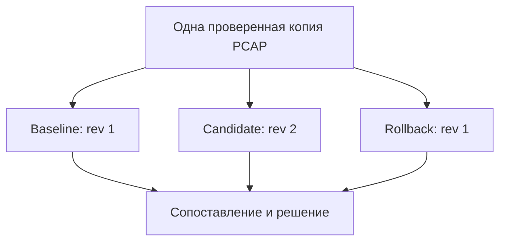

# Лабораторная работа №15 — Изменение правила: доказательство и откат

<div class="chapter-lead">
<p>Завершаем практикум проверяемым изменением обнаружения. Задача — <strong>уточнить условие правила, доказать результат на сохранённом трафике и проверить возврат к прежнему поведению</strong>. Итогом станет короткое обоснование изменения с артефактами, ограничениями и решением о дальнейших проверках.</p>
</div>

Используем прежний `idps-server`, Suricata 8, Python 3 и **оригинальную завершённую попытку №13**. Варианты с изменёнными журналами из №14 для этого опыта не подходят. Новые VM, сервисы и сетевые запросы не требуются. Все три запуска Suricata выполняются offline; действующую конфигурацию и firewall не меняем.

[Скачать пакет ЛР №15 v0.1](../../assets/downloads/idps-lab15-bundle-v0.1.zip){ .md-button .md-button--primary }
[SHA-256](../../assets/downloads/idps-lab15-bundle-v0.1.zip.sha256){ .md-button }

## 1. Заявка на изменение

В №13 правило выделяло подстроку `/lab13/export`. Поэтому оно срабатывало и на `/lab13/export-status`. Тогда задача обнаружения не требовала различать эти пути.

Теперь задаём **новое конкретное требование**:

> В рамках прежнего направления HTTP-трафика выделять обращение к пути `/lab13/export`, в том числе с query string. Не выделять `/lab13/health` и `/lab13/export-status`.

**Query string** — часть URI после `?`, например `lab13_request=...`. Она сохраняет идентификатор запроса из №13, но не должна превращать `/export-status` в целевой путь.

Это задача наблюдения за обращением к пути. Она не доказывает выгрузку данных, нарушение прав или атаку. Сервис №5 по-прежнему отражает путь в ответе, а не выполняет экспорт документов. При новой цели срабатывание на C является нежелательным результатом по этой спецификации; это не означает, что правило №13 было «сломано» в своей исходной задаче.

До запуска запишите в `report/lab15-report.md`: цель, ожидаемый результат для A/B/C, что остаётся неизменным, условия остановки и предел будущего вывода.

## 2. Что объединяет завершающая работа

| Предыдущие работы | Что применяем сейчас |
|---|---|
| №5–6 | Условие правила и явные положительные/отрицательные примеры |
| №8–10 | Различие обнаружения и блокирования; проверка реально загруженного правила |
| №11–12 | Нормализованный URI и ограничения известного тестового набора |
| №13 | Сопоставление клиентского обмена, HTTP и alert |
| №14 | Отказ от вывода при неполных или противоречивых данных |

Это итоговая лабораторная работа с фиксированным сценарием. Она не заменяет отдельный [итоговый проект СРО](../../resources/project-brief.md), где выбирается собственная ограниченная задача. Новую балльную шкалу не вводим.

## 3. Два правила и одна переменная эксперимента

Исходное `server/baseline.rules` совпадает с опубликованным правилом №13:

```suricata
alert http 10.13.37.10 any -> 10.13.37.20 8080 (msg:"LAB13 export path marker observed"; flow:established,to_server; http.uri; content:"/lab13/export"; sid:10000130; rev:1;)
```

Кандидат `server/candidate.rules`:

```suricata
alert http 10.13.37.10 any -> 10.13.37.20 8080 (msg:"LAB15 exact export path observed"; flow:established,to_server; http.uri; content:"/lab13/export"; startswith; pcre:"/^\/lab13\/export(?:\?|$)/"; sid:10000130; rev:2;)
```

`http.uri` выбирает нормализованный URI. `startswith` закрепляет `content` в начале буфера. PCRE — регулярное выражение: `^` означает начало, `\/` — буквальный `/`, `(?:\?|$)` допускает после `export` только буквальный `?` либо конец буфера. Поэтому суффикс `-status` не подходит. `content` также служит предварительным условием перед регулярным выражением.

`sid` сохраняет идентификатор правила, `rev` обозначает новую редакцию. Текст `msg` уточнён для аналитика. Адреса, направление, действие `alert` и смысл `flow` остаются прежними. В каждом запуске через `-S` загружается **один** файл с одним вариантом этого SID; вместе обе редакции не загружаются.

Один и тот же PCAP проходит три отдельных разбора:



**Rollback** здесь — повторный offline-разбор прежним правилом. Это проверка возврата поведения на том же входе, а не откат боевого сервиса: live-правило мы не развёртываем.

## 4. Подготовьте исходные материалы

На сервере нужна попытка №13 с PCAP, клиентской копией A/B/C, EVE, `active.rules` и `completed.txt`. Проверьте сохранённые манифесты №13:

```bash
cd ~/idps-lab13-bundle-v0.1
(cd evidence/client-copy && sha256sum -c SHA256SUMS)
sudo sha256sum -c server-evidence.sha256
```

При отличающемся расположении перейдите в фактический каталог. Отсутствующий старый манифест отметьте как ограничение происхождения. При несовпадении хешей остановитесь и установите причину; не заменяйте старый манифест новым ради успешной проверки.

Пакет №15 и его checksum сохраните рядом:

```bash
cd ~
sha256sum -c idps-lab15-bundle-v0.1.zip.sha256
unzip -l idps-lab15-bundle-v0.1.zip
test ! -e idps-lab15-bundle-v0.1 && unzip idps-lab15-bundle-v0.1.zip
cd idps-lab15-bundle-v0.1
sudo python3 tools/prepare.py ~/idps-lab13-bundle-v0.1
```

Продолжайте только после успешных проверок. Скрипт проверяет исходное сопоставление A=0, B=1, C=1 и соответствие сохранённого правила baseline, копирует входы в `evidence/inputs`, сохраняет хеши копий и оригиналов. Это исходное условие именно данного опыта. При иной картине вернитесь к разбору №13, не изменяйте её EVE вручную.

Повторная попытка — в новой распаковке, например `unzip idps-lab15-bundle-v0.1.zip -d lab15-attempt-02`. Существующий `evidence` не перезаписывается. Частичные результаты не удаляются автоматически.

## 5. Зафиксируйте прогноз и ограничения

| Проба из №13 | Требование новой задачи | Baseline, rev 1 | Candidate, rev 2 | Rollback, rev 1 |
|---|---|---:|---:|---:|
| A: `/lab13/health?...` | Нет alert этого SID | 0 | 0 | 0 |
| B: `/lab13/export?...` | Один alert этого SID | 1 | 1 | 1 |
| C: `/lab13/export-status?...` | Нет alert этого SID | 1 | 0 | 1 |

Числа — ожидаемое количество alerts на конкретный обмен, а не фактический результат до измерения.

Это три **известных** примера, использованных при выборе изменения. Они не являются независимым holdout-набором из №12. Переиспользование PCAP обеспечивает контролируемое сравнение, но не доказывает обобщение на другой трафик. Не заявляйте «100% обнаружение атак» по этой таблице.

## 6. Выполните три offline-разбора

Из каталога №15 последовательно, проверяя результат каждой команды:

```bash
sudo bash server/replay.sh baseline
sudo bash server/replay.sh candidate
sudo bash server/replay.sh rollback
```

После каждого запуска ожидается `REPLAY_COMPLETED` с названием этапа. При ошибке остановитесь, сохраните диагностику и не считайте этап завершённым.

Скрипт сначала выполняет `suricata -T`, затем offline-разбор с `-S` и `-r`. `-k none` используется только для прежнего виртуального лабораторного PCAP, где checksum offloading может влиять на сохранённые контрольные суммы пакетов. Это не настройка для произвольного production-трафика.

Для каждого этапа сохраняются активное правило, версия движка, копия основного YAML, команда, хеши входов, журналы валидации и разбора, отметки начала и успешного завершения. Проверки хешей выполняются до и после разбора. Системный YAML читается, но не изменяется.

Между этапами не обновляйте движок, конфигурацию или подключаемые файлы. Сравнение автоматически проверяет версию и основной YAML; оно **не снимает полный образ окружения**. Если конфигурация использует внешние include-файлы или другие зависимости, отдельно зафиксируйте их пути и хеши в отчёте. Несовпадающие условия не позволяют приписать разницу только правилу.

## 7. Сначала проверьте события вручную

Пример для кандидата:

```bash
sudo cat evidence/candidate/active.rules
sudo jq -c 'select(.event_type=="alert" and .alert.signature_id==10000130) | {timestamp,flow_id,tx_id,src_port,alert,http}' evidence/candidate/eve.json
sudo jq -c 'select(.event_type=="http") | {timestamp,flow_id,tx_id,src_port,http}' evidence/candidate/eve.json
```

Повторите для baseline и rollback. Проверьте:

- B сохранил alert, у него правильные SID/rev и связь с HTTP-транзакцией.
- В candidate C по-прежнему присутствует как HTTP GET/200 с исходным request ID, хотя целевого alert нет.
- A присутствует как контрольный обмен без целевого alert.
- При rollback возвращается прежняя картина B/C.

Проверка наличия HTTP C отличает «правило больше не выделяет этот запрос» от «запрос потерялся при анализе». Одного пустого списка alerts недостаточно.

Связывайте HTTP и alert внутри каждого запуска по `flow_id`, `tx_id` и порту. Между независимыми запусками используйте request ID, точный URI и клиентский обмен: не предполагайте, что `flow_id` обязан совпасть при повторном запуске Suricata.

При расхождении вернитесь к исходному PCAP и клиентским данным по методике №13. EVE трёх разборов — производные одного захвата, а не три независимых подтверждения сетевого события.

## 8. Выполните автоматическое сравнение

```bash
sudo python3 tools/compare.py
printf 'Код завершения: %s\n' "$?"
```

Скрипт проверяет сохранность входов, версии и основной YAML, копии правил и связь записей с клиентскими обменами. При сравнении редакции 2 допускается именно `rev:2`; это локальное расширение проверки №13, не изменение предыдущей работы.

Результаты сохраняются в `evidence/comparison/summary.json` и `linked-records.json`. В последнем есть URI, request ID, порты, timestamps и номера строк EVE каждого этапа.

| Результат | Что означает | Что делать |
|---|---|---|
| Код 0, три PASS | Картина трёх обменов соответствует прогнозу на всех этапах | Описать результат и границы, подготовить решение |
| Код 2, DIFFERENCE | Связи построены, но количество alerts отличается от прогноза | Исследовать правило и наблюдаемые события, сохранить расхождение |
| Код 1, INCOMPLETE_OR_INVALID | Входы, условия или связи непригодны для сравнения | Сначала восстановить пригодность данных; не считать пропуски отрицательными примерами |

Код 0 не проверяет точность часов, не удостоверяет всю историю происхождения и не решает, был ли инцидент. Уроки №14 продолжают действовать. Скрипт не разбирает PCAP самостоятельно и не заменяет ручную проверку при сомнении.

## 9. Примите решение по изменению

Заполните отчёт: **принять для дальнейшего расширенного тестирования**, **доработать** или **отклонить**. Укажите основание и ссылку на наблюдение. Даже при трёх PASS не выдавайте это за разрешение на промышленное внедрение.

Передайте следующему аналитику или инженеру:

1. Требование: какой путь нужно выделять и зачем.
2. Изменение: SID/rev, условие и хеш активного файла.
3. Проверенный эффект: судьба A/B/C в трёх разборах, ссылки на события.
4. Ограничения: один известный PCAP, прежняя точка наблюдения, отсутствие проверки production-нагрузки и шифрованного HTTP.
5. Следующую проверку, критерий принятия и условие возврата к прежней редакции.

Составьте план дополнительного набора, который вы **ещё не запускали**: точный путь без query string; другие параметры; `/lab13/export/`; `/prefix/lab13/export`; регистр и закодированные представления URI; несколько транзакций в одном соединении. До получения результатов задайте ожидания с учётом нормализации и требований приложения. Не записывайте эти случаи в таблицу выполненных тестов.

В реальном сопровождении также потребовались бы проверка на независимом трафике, оценка нагрузки, мониторинг после внедрения и контролируемое развёртывание. В этой работе они описываются как дальнейшие действия, а не как якобы выполненные этапы.

## 10. Завершение и сдача

После окончания записей:

```bash
sudo sha256sum -c evidence/inputs.sha256
sudo find evidence -type f -print0 | sort -z | sudo xargs -0 sha256sum > lab15-evidence.sha256
```

Сдайте заполненный `report/lab15-report.md`, папку `evidence`, итоговый манифест и оба файла правил. Сохраните оригинальную попытку №13 и её манифесты. Проверка оригиналов в `compare.py` относится к записанному пути: при переносе комплекта укажите новое расположение отдельно.

Хеш подтверждает байтовое соответствие записанному значению, но не доказывает авторство и достоверность наблюдения. Копия конфигурации может содержать сведения об окружении; для этой работы используйте только учебный стенд.

Убедитесь, что offline-процессы завершены. Никакое live-правило, служба или firewall в рамках №15 не менялись. Итог практикума — воспроизводимый ограниченный вывод, проверка возврата поведения и понятная передача результатов, а не только наличие alert.

## Проверьте понимание

1. Почему C соответствовал условию №13, но не новой задаче №15?
2. Зачем проверять HTTP-запись C после исчезновения его alert?
3. Что подтверждает offline-rollback и чего он не проверяет?
4. Почему три повторных разбора не дают независимый тестовый набор?
5. Почему одинаковый SID не заменяет проверку rev и активного файла?
6. Какие дополнительные результаты нужны перед внедрением изменения в другую среду?

Связь с теорией: [сопровождение возможностей обнаружения](../../course/10-operations-lifecycle.md).

Технические источники:

- [Suricata 8 — HTTP keywords](https://docs.suricata.io/en/suricata-8.0.7/rules/http-keywords.html): нормализованный HTTP URI и sticky buffers.
- [Suricata 8 — Payload keywords](https://docs.suricata.io/en/suricata-8.0.7/rules/payload-keywords.html): `content`, `startswith`, PCRE.
